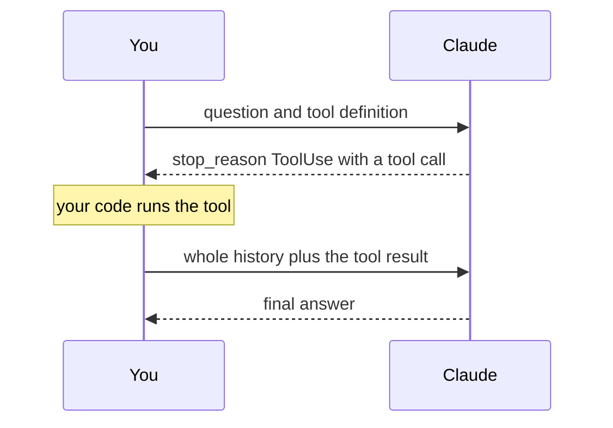

# Tools

A tool is a function you describe to Claude and run yourself. Claude never runs it. It asks you to,
you run it, and you send the result back.



## Define a tool and ask

A `Tool` has a name, a description and a JSON Schema for its input. `ToolChoice::Auto` lets Claude
decide whether to call it. The tool snippets use `serde_json` to write the schema, so add
`serde_json = "1"` to your dependencies.

```rust,no_run
use airsclaude::messages::tools::{Tool, ToolChoice};
use airsclaude::messages::ContentBlock;
use airsclaude::prelude::*;
use airsclaude::types::ToolName;

# #[tokio::main]
# async fn main() -> Result<(), Box<dyn std::error::Error>> {
# let api_key = ApiKey::new(std::env::var("ANTHROPIC_API_KEY")?)?;
# let client = Client::builder()?.api_key(api_key).build()?;
let tool = Tool {
    name: ToolName::new("get_weather")?,
    description: "Look up the current weather for a city.".into(),
    input_schema: serde_json::json!({
        "type": "object",
        "properties": { "city": { "type": "string" } },
        "required": ["city"]
    }),
    cache_control: None,
    strict: None,
    eager_input_streaming: None,
};

let req = MessageRequest::builder()
    .model(ModelId::claude_sonnet_5())
    .max_tokens(MaxTokens::new(1024))
    .add_user_text("What is the weather in Paris?")
    .tools([tool])
    .tool_choice(ToolChoice::Auto)
    .build();

let assistant_msg = client.messages().create(req).await?;

let Some(tu) = assistant_msg.content.iter().find_map(|b| match b {
    ContentBlock::ToolUse(tu) => Some(tu.clone()),
    _ => None,
}) else {
    println!("Claude did not call the tool.");
    return Ok(());
};

println!("Tool called: {} with input: {}", tu.name.as_str(), tu.input);
# Ok(())
# }
```

When Claude calls the tool, the reply has `stop_reason` `ToolUse` and a `ContentBlock::ToolUse` block.
The block carries an `id`, the tool's `name`, and an `input` that matches your schema.

## Answer the call

Run your function, wrap what it returns in a `ToolResultBlock` tied to the call's `id`, and send the
conversation again with that result added.

```rust,no_run
use airsclaude::messages::tools::{Tool, ToolChoice, ToolResultBlock};
use airsclaude::messages::{ContentBlock, ContentBlockParam, MessageContent, Role};
use airsclaude::prelude::*;
use airsclaude::types::ToolName;

# #[tokio::main]
# async fn main() -> Result<(), Box<dyn std::error::Error>> {
# let api_key = ApiKey::new(std::env::var("ANTHROPIC_API_KEY")?)?;
# let client = Client::builder()?.api_key(api_key).build()?;
# let max_tokens = MaxTokens::new(1024);
# let tool = Tool {
#     name: ToolName::new("get_weather")?,
#     description: "Look up the current weather for a city.".into(),
#     input_schema: serde_json::json!({
#         "type": "object",
#         "properties": { "city": { "type": "string" } },
#         "required": ["city"]
#     }),
#     cache_control: None,
#     strict: None,
#     eager_input_streaming: None,
# };
# let req = MessageRequest::builder()
#     .model(ModelId::claude_sonnet_5())
#     .max_tokens(max_tokens)
#     .add_user_text("What is the weather in Paris?")
#     .tools([tool.clone()])
#     .tool_choice(ToolChoice::Auto)
#     .build();
# let assistant_msg = client.messages().create(req).await?;
# let Some(tu) = assistant_msg.content.iter().find_map(|b| match b {
#     ContentBlock::ToolUse(tu) => Some(tu.clone()),
#     _ => None,
# }) else {
#     return Ok(());
# };
// Your code would look the weather up here.
let result_body =
    serde_json::json!({"temperature": "18°C", "condition": "partly cloudy"}).to_string();
let tool_result = ToolResultBlock::text(tu.id.clone(), result_body);

let follow_up = MessageRequest::builder()
    .model(ModelId::claude_sonnet_5())
    .max_tokens(max_tokens)
    .add_message(
        Role::User,
        MessageContent::Text("What is the weather in Paris?".into()),
    )
    .add_message(
        Role::Assistant,
        MessageContent::Blocks(vec![ContentBlockParam::ToolUse(tu)]),
    )
    .add_message(
        Role::User,
        MessageContent::Blocks(vec![ContentBlockParam::ToolResult(tool_result)]),
    )
    .tools([tool])
    .build();

let final_msg = client.messages().create(follow_up).await?;
for block in &final_msg.content {
    if let ContentBlock::Text(t) = block {
        println!("{}", t.text);
    }
}
# Ok(())
# }
```

Claude answers using the weather you supplied.

The follow-up replays the whole conversation: the original question, the assistant's tool call and
your result. The API is stateless, so every request carries its own history.

The tool-use block also changes type on the way back. What comes back is a `ContentBlock::ToolUse`,
and what you send is a `ContentBlockParam::ToolUse`. They are two different enums, on purpose, so a
block you received is not sent back by accident.

## Run the example

```bash
cargo run -p airsclaude --example 03_tools
```

The full program is
[`03_tools`](https://github.com/airsstack/claudestacks/tree/main/crates/airsclaude/examples/messages/03_tools).
To keep answering tool calls until Claude is done, see
[`07_agentic_tool_loop`](https://github.com/airsstack/claudestacks/tree/main/crates/airsclaude/examples/messages/07_agentic_tool_loop)
and [Building Something Larger](ch02-08-building-larger.md).
