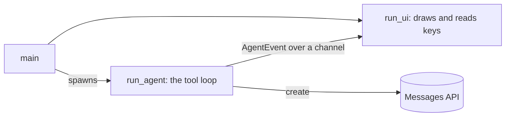

# Building Something Larger

The earlier chapters each use one feature in a short script. An application combines them: a
conversation that grows, tools that do real work, and a loop that runs until the model is done. This
chapter points you at a complete program that does that, then shows the one client setting you reach
for when an application already owns its HTTP stack.

## A complete coding agent

The
[coding agent example](https://github.com/airsstack/claudestacks/tree/main/crates/airsclaude/examples/messages/11_coding_agent)
is a terminal program built on the Messages client. The model writes files, reads them back and runs
`cargo`, using real tools, and keeps going until the program it was asked to write builds and runs. A
[`ratatui`](https://ratatui.rs) interface shows the run as it happens.

It is the tool loop from the
[`07_agentic_tool_loop`](https://github.com/airsstack/claudestacks/tree/main/crates/airsclaude/examples/messages/07_agentic_tool_loop)
example with two additions. The tools are real, and the loop
runs beside a user interface instead of printing to a terminal.



The agent task and the interface run apart because the interface must stay responsive while the agent
waits on the network and on `cargo`. They talk to each other over a channel.

The example fences the agent in. Every path a tool receives is rejected if it is absolute or contains
`..`, and is then resolved inside a sandbox directory. `cargo` always runs in that directory, and the
loop stops after 20 turns. It still runs `cargo` with whatever arguments the model supplies, so run it
where you are comfortable with that.

## Swapping the HTTP transport

`Client::builder()` builds a default `reqwest` transport, and that construction can fail, for example
when the TLS backend does not initialize. When you already hold a configured transport, hand it over
with `Client::builder_with_transport` instead. That call cannot fail, because nothing is left to
construct.

```rust,no_run
# use airsclaude::prelude::*;
use airsclaude::transport::ReqwestTransport;

# fn main() -> Result<(), Box<dyn std::error::Error>> {
let transport = ReqwestTransport::try_new()?;
let api_key = ApiKey::new(std::env::var("ANTHROPIC_API_KEY")?)?;

let client = Client::builder_with_transport(transport)
    .api_key(api_key)
    .build()?;
# let _ = client;
# Ok(())
# }
```

The rest of the builder works as it does for `Client::builder()`, so the API key, beta headers,
timeout, retry policy and base URL are set the same way.

`ReqwestTransport::from_client` wraps a `reqwest::Client` you have configured yourself, with your own
timeouts, proxies, TLS roots or instrumentation. Any type that implements the crate's `Transport`
trait for HTTP requests and responses also works, which is how a test double stands in for the
network.

`Client<T>` is generic over the transport. The choice is made at compile time, so it costs no dynamic
dispatch. [How the Messages Client Is Built](ch04-02-messages-design.md) explains the structure.
