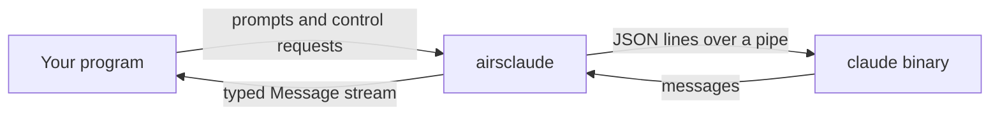

# The Agent SDK

The Agent SDK runs Claude Code from your Rust program. It starts the `claude` binary as a child
process, sends it prompts, and hands you back what the agent does as a stream of typed messages. The
agent reads files, runs tools and edits code the same way it does in a terminal, and your program
watches, steers and interrupts it.

It does not call the HTTP API. There is no API key to set, because the `claude` binary brings its own
credentials. If you want to send a single request to a model and get text back, use
[the Messages API](ch02-00-messages-api.md) instead.



## Prerequisites

You need a `claude` binary, version 2.0.0 or newer. The SDK looks for it in three places, in this
order:

1. The path you give to `Options::path_to_executable`, if you set one.
2. Every directory on your `PATH`.
3. `$HOME/.claude/local/claude`.

Check what you have:

```bash
claude --version
```

This is the output on the machine that wrote this page:

```text
2.1.318 (Claude Code)
```

No `ANTHROPIC_API_KEY` is needed. The SDK reuses whatever credentials the binary already holds, so if
`claude` works in your shell, the SDK works. This command talks to the service and spends usage, so
run it only when you want to confirm that:

```bash
claude -p "hi"
```

## What is in this chapter

Each page builds on the one before it.

| Page | What you do |
|---|---|
| [Your First Session](ch03-01-first-session.md) | Send a prompt and read the reply |
| [Conversations](ch03-02-conversations.md) | Keep a session across turns and interrupt it |
| [Controlling the Agent](ch03-03-controlling-the-agent.md) | Set the model, gate tools, delegate to subagents |
| [Your Code in the Loop](ch03-04-your-code-in-the-loop.md) | Approve tool calls, react to events, expose Rust tools |
| [Sessions](ch03-05-sessions.md) | Resume, fork and list past sessions |
| [Building Something Interactive](ch03-06-interactive.md) | Drive an agent from a terminal program |

To see how the SDK is put together, read [How the Agent SDK Is Built](ch04-03-agent-layers.md).

## Running the examples

The crate ships fourteen complete programs in
[`crates/airsclaude/examples/agent/`](https://github.com/airsstack/claudestacks/tree/main/crates/airsclaude/examples/agent),
each in its own directory with a README. Every Agent SDK example is registered under a name that starts
with `agent_`, so none collides with a Messages API example, and each runs from anywhere in the
workspace:

```bash
cargo run -p airsclaude --example agent_01_query
```

Running an example starts a real session, so it spends usage. The pages in this chapter print no output
for such commands, because the reply is different on every run.
