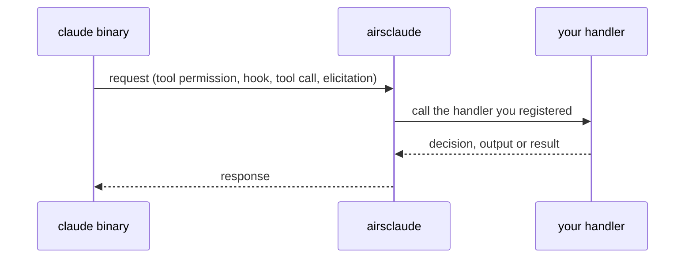

# Your Code in the Loop

Most of the Agent SDK lets you watch a turn. Four traits let your Rust code take part in it. You
implement one, register it on `Options`, and the SDK calls it as the turn proceeds.

| Trait | The binary asks | You answer with |
|---|---|---|
| `PermissionPolicy` | may this tool run with this input? | `PermissionDecision` |
| `Hook` | an event you registered for has fired | `HookOutput` |
| `Tool` | the model called one of your tools | `ToolResult` |
| `ElicitationPolicy` | an MCP server wants input from the user | `ElicitationResponse` |



The handler runs in your process, so it can do anything your program can: read a database, ask a
person, call another service. Its answer goes back to the binary and decides what happens next.

## Approve, rewrite or deny a tool call

Implement `PermissionPolicy` to be asked before a gated tool runs. The policy sees the tool name and its
input, and returns one of four answers:

- `PermissionDecision::allow()` runs the call unchanged.
- `PermissionDecision::allow_with(input)` runs it with the input you supply.
- `PermissionDecision::deny(message)` refuses this call and lets the turn continue.
- `PermissionDecision::deny_interrupt(message)` refuses it and ends the turn.

The handler traits are `async` traits. The snippets on this page implement them with `async-trait` and
write JSON with `serde_json`, so add `async-trait = "0.1"` and `serde_json = "1"` to your dependencies.

```rust
use std::sync::Arc;

use airsclaude::agent::cancel::CancelSignal;
use airsclaude::agent::error::AgentError;
use airsclaude::agent::{
    Options, PermissionContext, PermissionDecision, PermissionMode, PermissionPolicy,
};

/// Lets `ls` through as `ls -la` and refuses every other command.
struct ReadOnlyShell;

#[async_trait::async_trait]
impl PermissionPolicy for ReadOnlyShell {
    async fn can_use_tool(
        &self,
        tool: &str,
        input: &serde_json::Value,
        _ctx: PermissionContext,
        _cancel: CancelSignal,
    ) -> Result<PermissionDecision, AgentError> {
        let command = input.get("command").and_then(serde_json::Value::as_str);
        if tool == "Bash" && command == Some("ls") {
            let mut rewritten = input.clone();
            rewritten["command"] = "ls -la".into();
            return Ok(PermissionDecision::allow_with(rewritten));
        }
        Ok(PermissionDecision::deny(format!("{tool} is not allowed here")))
    }
}

let options = Options::builder()
    // `Default` asks; `BypassPermissions` skips the policy entirely.
    .permission_mode(PermissionMode::Default)
    .permission_policy(Arc::new(ReadOnlyShell))
    .build();
# let _ = options;
```

Do not also name `Bash` in `allowed_tools`. The binary's own message says that a bare `allowedTools`
entry approves the whole tool before the callback is consulted, so your policy would never see a `Bash`
call. The same message says `BypassPermissions` approves every tool call without consulting it.

A decision can also carry `PermissionUpdate` rules that last for the rest of the session. That is how
"always allow this" is expressed. The `PermissionContext` argument carries the binary's own title for the
request and the rule updates it suggests.

The [example](https://github.com/airsstack/claudestacks/tree/main/crates/airsclaude/examples/agent/05_permissions)
shows the session rules and a policy that counts the calls it has judged.

## React to lifecycle events, or veto one

Implement `Hook` and register it against a `HookEvent`, optionally narrowed by a matcher. A hook that
returns the default `HookOutput` only observes. It can also inject a `system_message` into the
conversation, or set `decision` to `HookDecision::Block` to stop the step.

```rust
use std::sync::Arc;

use airsclaude::agent::cancel::CancelSignal;
use airsclaude::agent::error::AgentError;
use airsclaude::agent::{Hook, HookDecision, HookEvent, HookInput, HookOutput, Options};

/// Blocks any `Bash` command that deletes files.
struct BlockDeletes;

#[async_trait::async_trait]
impl Hook for BlockDeletes {
    async fn call(&self, input: HookInput, _cancel: CancelSignal) -> Result<HookOutput, AgentError> {
        let command = input
            .data
            .get("tool_input")
            .and_then(|tool_input| tool_input.get("command"))
            .and_then(serde_json::Value::as_str)
            .unwrap_or_default();

        if command.contains("rm ") {
            return Ok(HookOutput {
                decision: Some(HookDecision::Block),
                reason: Some(format!("`{command}` deletes files")),
                ..HookOutput::default()
            });
        }
        Ok(HookOutput::default())
    }
}

let options = Options::builder()
    // The matcher narrows this hook to the `Bash` tool.
    .hook(HookEvent::PreToolUse, Some("Bash".to_owned()), Arc::new(BlockDeletes))
    .build();
# let _ = options;
```

`HookInput` carries the event, the id of the tool call when there is one, and `data`, the binary's own
event payload, which the SDK passes through as JSON. Events cover tools (`PreToolUse`, `PostToolUse`,
`PostToolUseFailure`), the turn (`UserPromptSubmit`, `Stop`), subagents (`SubagentStart`,
`SubagentStop`), the session (`SessionStart`, `SessionEnd`), compaction (`PreCompact`) and more.

A hook and a permission policy do different jobs. A policy answers whether a tool may run. A hook runs
around a step, and it also fires on events that have nothing to do with tools. To receive the binary's
hook-lifecycle frames on the message stream as well, set `include_hook_events(true)`; they arrive as
`Message::Other`, because the SDK does not model their shape.

The [example](https://github.com/airsstack/claudestacks/tree/main/crates/airsclaude/examples/agent/06_hooks)
registers observers on four events next to the blocking hook.

## Expose a Rust function as a tool the model can call

`tool` turns a closure into a tool, and `SdkMcpServer` groups tools into a server that runs inside your
process. There is no separate MCP server to launch.

```rust
use airsclaude::agent::{Options, PermissionMode, SdkMcpServer, ToolResult, tool};

let word_count = tool(
    "word_count",
    "Count the words in a piece of text.",
    serde_json::json!({
        "type": "object",
        "properties": { "text": { "type": "string" } },
        "required": ["text"]
    }),
    |args| async move {
        let text = args.get("text").and_then(serde_json::Value::as_str).unwrap_or_default();
        Ok(ToolResult::text(text.split_whitespace().count().to_string()))
    },
);

let server = SdkMcpServer::builder("calc").version("1.0.0").tool(word_count).build();

let options = Options::builder()
    .permission_mode(PermissionMode::Default)
    // Tools from an in-process server are named `mcp__<server>__<tool>`.
    // Naming one here approves it without asking. Other tools are not approved by this line.
    .allowed_tools(vec!["mcp__calc__word_count".to_owned()])
    .sdk_mcp_server(server)
    .build();
# let _ = options;
```

The snippet does not use `BypassPermissions`. The binary's own message says that mode approves every
tool call, so it would let the agent run any tool it has, not only `word_count`.

The description and the JSON Schema are what the model reads to decide when and how to call the tool,
so they are worth writing carefully. Return `ToolResult::error(message)` to report a failure to the
model without ending the session. The model can read the message and try again. Returning `Err` from the
handler has the same effect: the model sees an error result and the session carries on.

Implement the `Tool` trait directly when a closure is not enough, and attach `ToolAnnotations`, such as
`read_only_hint`, to describe what kind of operation a tool performs.

The [example](https://github.com/airsstack/claudestacks/tree/main/crates/airsclaude/examples/agent/07_mcp_tools)
adds a second tool that returns an error result and an `ElicitationPolicy`.

## Answer an MCP server that asks the user for input

An MCP server can stop in the middle of a tool call and ask for input. Implement `ElicitationPolicy` and
register it with `elicitation_policy`. The request says which server is asking, carries a message, and
names a mode: a form with a JSON Schema the answer must satisfy, or a URL for the user to visit. You
return `ElicitationResponse::Accept` with the answer, `Decline` or `Cancel`. With no policy registered,
the SDK declines every request.

## Cancellation is cooperative

`PermissionPolicy`, `Hook` and `ElicitationPolicy` each receive a `CancelSignal`. If the binary withdraws
a request while your handler is still working, the signal fires. Nothing stops your handler: one that
ignores the signal runs to completion and its answer is still sent. A handler that waits on something
slow should watch the signal and return early.

```rust
use airsclaude::agent::cancel::CancelSignal;
use airsclaude::agent::error::AgentError;

async fn wait_for_answer(cancel: CancelSignal) -> Result<bool, AgentError> {
    tokio::select! {
        // Stand-in for a slow wait, such as a person at a prompt.
        () = tokio::time::sleep(std::time::Duration::from_secs(60)) => Ok(true),
        () = cancel.cancelled() => Err(AgentError::Interrupted),
    }
}
# let _ = wait_for_answer;
```

`Tool::call` takes only the input, with no `CancelSignal`.
[How the Agent SDK Is Built](ch04-03-agent-layers.md) follows a request from the binary to your handler
and back.
