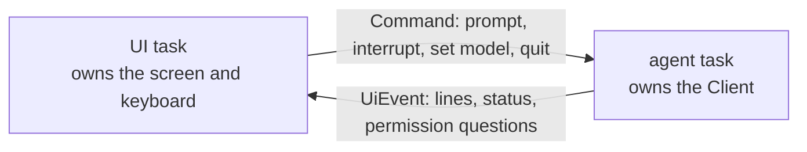

# Building Something Interactive

A program that a person drives has to do two things at once. It streams the agent's turn to the screen,
and it keeps listening: for a key that interrupts the turn, for a command that switches the model, for
the answer to a permission question. This chapter shows the shape that makes that work. The complete
program is the [agent console](https://github.com/airsstack/claudestacks/tree/main/crates/airsclaude/examples/agent/14_agent_console),
a `ratatui` terminal UI with live tool activity, permission prompts answered from the keyboard, and a
key that interrupts the running turn. If you are wiring the SDK into a real application, it is the
example to read.

## Two tasks and two channels



The agent task owns the `Client`. A `Client` is not `Clone`, and keeping it in one task means nothing
needs to be shared. The UI never calls the SDK. It sends commands down one channel and draws the events
that come back on the other.

The snippets on this page use `tokio` channels and `select!`, `futures-util` and `async-trait`. Add
`tokio = { version = "1", features = ["macros", "rt-multi-thread", "sync"] }`, `futures-util = "0.3"` and
`async-trait = "0.1"` to your dependencies.

Define the two messages first.

```rust
use airsclaude::types::ModelId;

/// What the UI asks the agent task to do.
enum Command {
    Prompt(String),
    Interrupt,
    SetModel(ModelId),
    Quit,
}

/// What the agent task tells the UI to show.
enum UiEvent {
    Line(String),
    TurnDone,
}
# let _ = (Command::Interrupt, UiEvent::TurnDone);
```

## Stay responsive during a turn

The turn loop waits on the frame stream and the command channel together. That is what lets an
interrupt reach `Client::interrupt` while frames are still arriving.

```rust,no_run
# async fn run() -> Result<(), Box<dyn std::error::Error>> {
use airsclaude::agent::{AgentError, Client, ContentBlock, Message, Options};
use airsclaude::types::ModelId;
use futures_util::StreamExt;
use tokio::sync::mpsc::{UnboundedReceiver, UnboundedSender, unbounded_channel};

enum Command {
    Prompt(String),
    Interrupt,
    SetModel(ModelId),
    Quit,
}

enum UiEvent {
    Line(String),
    TurnDone,
}

/// Stream one turn, listening for commands while it runs.
/// Returns `true` if the person asked to quit during the turn.
async fn run_turn(
    client: &Client,
    prompt: &str,
    commands: &mut UnboundedReceiver<Command>,
    events: &UnboundedSender<UiEvent>,
) -> Result<bool, AgentError> {
    let mut quit = false;
    let mut stream = client.query(prompt).await?;
    loop {
        tokio::select! {
            Some(command) = commands.recv() => match command {
                Command::Interrupt => {
                    client.interrupt().await?;
                }
                Command::Quit => {
                    quit = true;
                    break;
                }
                // A prompt or model change typed mid-turn is dropped.
                Command::Prompt(_) | Command::SetModel(_) => {}
            },
            frame = stream.next() => match frame {
                None => break,
                Some(frame) => match frame? {
                    Message::Assistant(assistant) => {
                        for block in &assistant.content {
                            if let ContentBlock::Text { text } = block {
                                let _ = events.send(UiEvent::Line(text.clone()));
                            }
                        }
                    }
                    // The result frame ends the turn.
                    Message::Result(_) => break,
                    _ => {}
                },
            },
        }
    }
    let _ = events.send(UiEvent::TurnDone);
    Ok(quit)
}

/// Own the session and service commands until told to quit.
async fn run_agent(
    mut commands: UnboundedReceiver<Command>,
    events: UnboundedSender<UiEvent>,
) -> Result<(), AgentError> {
    let client = Client::connect(Options::default()).await?;
    while let Some(command) = commands.recv().await {
        match command {
            Command::Prompt(text) => {
                if run_turn(&client, &text, &mut commands, &events).await? {
                    break;
                }
            }
            Command::SetModel(model) => client.set_model(model).await?,
            // Nothing is running, so there is nothing to interrupt.
            Command::Interrupt => {}
            Command::Quit => break,
        }
    }
    Ok(())
}

let (command_tx, command_rx) = unbounded_channel();
let (event_tx, _event_rx) = unbounded_channel();
tokio::spawn(run_agent(command_rx, event_tx));
command_tx.send(Command::Prompt("Say hello.".to_owned()))?;
# Ok(())
# }
```

The loop ends on the result frame, not on the interrupt: `interrupt` is a request, and the turn is over
when the stream says so. The console reports a failed frame and keeps going. Here a failure ends the
turn with `?`, which is the simpler choice for a small program.

## Turn a permission request into a question

A `PermissionPolicy` can decide nothing itself. It forwards the question to the UI and waits for the
person's answer. A `oneshot` channel carries the reply.

```rust
use airsclaude::agent::cancel::CancelSignal;
use airsclaude::agent::error::AgentError;
use airsclaude::agent::{PermissionContext, PermissionDecision, PermissionPolicy};
use tokio::sync::{mpsc, oneshot};

/// A question for the UI, with the channel to answer it on.
struct Question {
    tool: String,
    reply: oneshot::Sender<bool>,
}

struct AskTheUser {
    to_ui: mpsc::UnboundedSender<Question>,
}

#[async_trait::async_trait]
impl PermissionPolicy for AskTheUser {
    async fn can_use_tool(
        &self,
        tool: &str,
        _input: &serde_json::Value,
        _ctx: PermissionContext,
        cancel: CancelSignal,
    ) -> Result<PermissionDecision, AgentError> {
        let (reply, answer) = oneshot::channel();
        let question = Question { tool: tool.to_owned(), reply };
        if self.to_ui.send(question).is_err() {
            return Ok(PermissionDecision::deny("the UI is closed"));
        }

        tokio::select! {
            answer = answer => match answer {
                Ok(true) => Ok(PermissionDecision::allow()),
                Ok(false) => Ok(PermissionDecision::deny("denied by the user")),
                Err(_) => Ok(PermissionDecision::deny("the UI is closed")),
            },
            () = cancel.cancelled() => Err(AgentError::Interrupted),
        }
    }
}
# let _ = |q: Question| q.tool;
```

Three choices in that policy matter:

- The UI holds the `oneshot` sender next to the question it drew and fires it on the keystroke.
- A dropped sender, or a closed UI, denies the call. A permission gate should fail closed.
- `cancel.cancelled()` is in the `select!`. The binary can withdraw a request while the person is still
  deciding. Without that arm the policy would wait on a keystroke for a call nobody is waiting on.
  [Your Code in the Loop](ch03-04-your-code-in-the-loop.md) explains why that check is the handler's job.

Register the policy with `Options::permission_policy`. That makes the SDK start the binary with
`--permission-prompt-tool stdio`, in any permission mode. Two settings keep a call away from the policy.
The binary's own message says a bare `allowed_tools` entry approves the whole tool before the callback is
consulted, and that `PermissionMode::BypassPermissions` approves every tool call. Leave both out of a
program that wants to ask.
