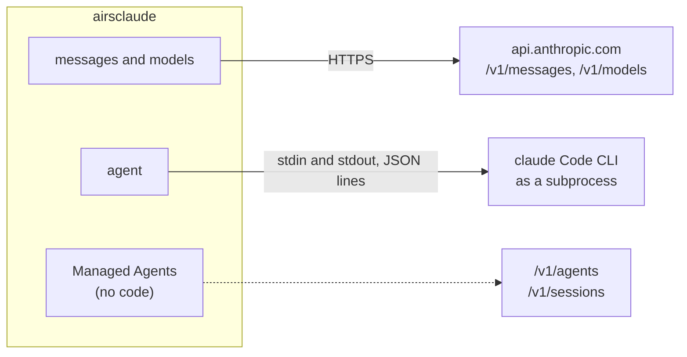

# Three Pillars

`airsclaude` bundles clients for what Anthropic ships as separate products. The two clients it
implements are not layers of one system. They are neighbours. One speaks HTTP to `api.anthropic.com`.
The other starts a binary and speaks line-delimited JSON down a pipe. Neither calls into the other.

| Pillar | Official counterpart | Module | State |
|---|---|---|---|
| Messages API | The base SDK (`@anthropic-ai/sdk`, `anthropic`): a stateless `POST /v1/messages` client | `airsclaude::messages`, `airsclaude::models` | Implemented |
| Agent SDK | `@anthropic-ai/claude-agent-sdk`, `claude-agent-sdk`: drives the `claude` Code CLI as a subprocess | `airsclaude::agent` | Implemented |
| Managed Agents | The beta server-hosted agents at `/v1/agents`, `/v1/sessions` and `/v1/environments` | None | Absent |

Managed Agents has no code in the crate. Nothing in `src/` mentions `managed_agent`, `/v1/agents` or
`/v1/environments`.



Pick the pillar by what you want to run. If you want a model's reply to a prompt, use the
[Messages API](ch02-00-messages-api.md). If you want the agent that reads files and runs tools, use
the [Agent SDK](ch03-00-agent-sdk.md).

## What the pillars share

Almost nothing. The exceptions are the only places a change in one can reach the other.

- **The validating types in `airsclaude::types`.** `ModelId` is used by both. `EffortLevel` is defined
  once and re-exported into the `agent` namespace, so the `effort` option of an agent session and the
  `output_config.effort` field of a Messages request are the same type.
- **`OutputConfig`.** The structured-output config lives in `airsclaude::messages`, and the Agent SDK
  reads it to turn a schema into the `--json-schema` flag. This is the only place the agent code
  depends on the Messages code.

Nothing in `airsclaude::messages` refers to `agent`. The dependency runs one way.

Here is `EffortLevel` crossing the boundary. Nothing in this snippet reaches a service:

```rust
use airsclaude::agent::{self, EffortLevel};
use airsclaude::messages::MessageRequest;
use airsclaude::types::{MaxTokens, ModelId};

// One value, two pillars.
let session = agent::Options::builder().effort(EffortLevel::High).build();
let request = MessageRequest::builder()
    .model(ModelId::claude_sonnet_5())
    .max_tokens(MaxTokens::new(64))
    .effort(EffortLevel::High)
    .build();

assert_eq!(session.effort, Some(EffortLevel::High));
assert_eq!(
    serde_json::to_value(&request).unwrap()["output_config"]["effort"],
    "high"
);
```

The next two pages take each client apart. Start with
[the Messages client](ch04-02-messages-design.md) or [the Agent SDK](ch04-03-agent-layers.md).
