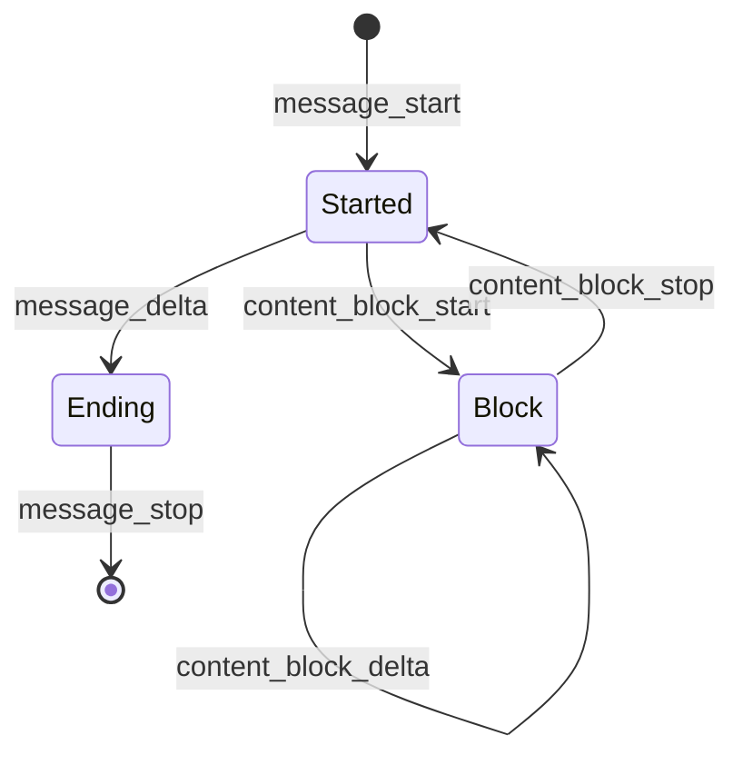

# How the Messages Client Is Built

This page explains why the Messages API client has the shape it has. For how to use it, start at
[the Messages API chapter](ch02-00-messages-api.md).

## Generic over the transport, cheap to clone

`Client<T = ReqwestTransport>` takes its HTTP transport as a type parameter instead of holding a
boxed trait object.

Two things follow. A fake transport can stand in for the network in tests, and because `T` is a
concrete type at compile time, none of that costs a virtual call at runtime. And you can bring your
own transport, such as a `reqwest` client with custom timeouts, connection pooling or proxy settings,
through `Client::builder_with_transport`. That entry point is infallible, because nothing is built.
`Client::builder()` is fallible because it does build a `ReqwestTransport`, and starting the TLS
backend can fail.

Cloning is a reference-count bump. All state sits behind an `Arc`, so handing a client to twenty callers
copies a pointer twenty times. `Client::ref_count` makes that visible.

You reach each API area through a handle that borrows the client. Make the handle at the call site
instead of storing it: `client.messages()`, `client.models()` and `client.messages().batches()`.

## Builders that will not compile when incomplete

Two type-state builders sit at the front of the client. They exist to remove a class of error, not to
look clever.

`ClientBuilder` starts in a state with no `build` method. The method is not there to return
`Err(MissingApiKey)`. Calling `.api_key(...)` consumes the builder and returns one that has `build`.
A client without credentials is therefore a program that does not compile, with no error to handle and
no test to write for it. The state markers are sealed, so no other crate can add a third state and
route around the check.

`MessageRequest::builder()` follows the same rule. It offers `build` only after both `model` and
`max_tokens` are set.

```rust
use airsclaude::prelude::*;

let key = ApiKey::new("sk-ant-example")?;
let client = Client::builder()?.api_key(key).build()?;

// A clone shares the same state.
let other = client.clone();
assert_eq!(client.ref_count(), 2);
drop(other);
assert_eq!(client.ref_count(), 1);
# Ok::<(), Box<dyn std::error::Error>>(())
```

Building a client reaches no service. Removing the `.api_key(key)` line leaves a program the compiler
rejects.

## Two content-block types, not one

This is the design choice most worth understanding.

Responses and requests use different sets of content blocks. A response can carry kinds this crate
cannot send back, such as `server_tool_use` or `container_upload`. Modelling both directions with one loose
union lets you pass either anywhere, and in Rust that leads to a failure at the worst moment: you echo
an assistant turn into the next request, which is the ordinary multi-turn pattern, and one of its
blocks cannot be sent. With one shared type, the program compiles and then fails at serialization
time, in production.

So there are two types. `ContentBlock` is what comes back, and it models all twelve response kinds.
`ContentBlockParam` is what you send, and it models six: `text`, `thinking`, `tool_use`,
`tool_result`, `image` and `document`. They share their leaf structs, so `TextBlock` and
`ThinkingBlock` are defined once.

The multi-turn pattern still has to work, so the conversion exists and can fail:

```rust
use airsclaude::messages::{ContentBlock, ContentBlockParam, TextBlock};

// Blocks both directions share convert.
let reply = vec![ContentBlock::Text(TextBlock::new("hi"))];
let echoed = ContentBlockParam::try_from_response(reply)?;
assert_eq!(echoed.len(), 1);

// A block the crate cannot send fails, and the error names it.
let unsendable = ContentBlock::Unknown(serde_json::json!({"type": "server_tool_use"}));
let err = ContentBlockParam::try_from(unsendable).unwrap_err();
assert_eq!(err.block_type(), "server_tool_use");
# Ok::<(), Box<dyn std::error::Error>>(())
```

`try_from_response` is all or nothing. It fails on the first block that cannot be sent instead of
quietly dropping it, because sending a shorter history than you meant to is worse than an error.

`ContentBlockParam` has no `Unknown` arm. It does not need one: you only ever build block kinds the
crate names.

## Unknown values are kept, not discarded

The API's streaming documentation tells clients to handle event types they do not recognise
gracefully. A client that fails to decode one is wrong, not strict.

So the open-ended enums decoded from a server response have an unknown arm. That covers `ContentBlock`,
`ContentDelta`, `StreamEvent`, `StopReason` and the batch and model kind enums, among others.
`BatchResult` and `ServerToolName` are closed and have none. Where an arm exists, it
carries the payload, not only a note that something was unrecognised. A block this release does not
model still arrives as `ContentBlock::Unknown(Value)` with its full JSON, so you can inspect it, log
it, or handle it before the crate learns about it. Discarding the payload would lose information the
server sent.

`ContentBlock::Unknown` is the one asymmetric case. It reads but does not write: serializing it is an
error. Echoing back a block nobody understands is worse than refusing to.

One consequence follows from the mechanism. A payload-carrying fallback also absorbs a block whose
type is known but whose body does not fit its variant. A `server_tool_use` with a `name` outside the
known set lands in `Unknown` instead of failing the response. The crate degrades the one block and
keeps the rest.

## Validation happens at construction

`airsclaude::types` holds validating newtypes: `ApiKey`, `BaseUrl`, `ModelId`, `MaxTokens`,
`Temperature`, `TopP`, `TopK`, `BetaHeader` and `AnthropicVersion`. The rule is to parse a value once,
at the boundary, and trust the type afterwards. `BaseUrl::parse` checks the scheme once. The builder
that stores it never re-checks, and `build()` never has to return a URL error.

`MaxTokens::new` is infallible, on purpose. Every `u32` is a legal `max_tokens`, including `0`, which
the API documents as a way to warm a prompt cache without generating anything.

## The streaming accumulator

`create` returns a whole `Message`. `stream` returns events, and events are a construction protocol
for a message, not a message. Something has to hold the partial state, and that is
`MessageAccumulator`. The rules only make sense against the event order:



`message_start` sets the snapshot. `content_block_start` pushes a block and must address the next
position, or the accumulator reports an error. `content_block_stop` finishes a block and parses any
buffered tool arguments. `message_delta` folds in the stop reason and usage.

Each delta kind has its own rule, and they are not the same rule:

| Delta | What the accumulator does |
|---|---|
| `text_delta` | Concatenates onto the text block |
| `thinking_delta` | Concatenates onto the thinking block |
| `signature_delta` | Replaces the signature |
| `citations_delta` | Appends to the text block's citations |
| `input_json_delta` | Buffers the raw fragment beside the snapshot |

Tool arguments are the interesting case. They stream as raw JSON fragments that are valid only once
joined, such as `{"cit`, `y": "Par` and `is"}`, so each one cannot be parsed as it arrives. They go
into a side buffer and are parsed once, at `content_block_stop`, then written onto the tool block. An
empty buffer is left alone, so the `input` the block opened with survives.

The signature rule matters more than it looks. A thinking block's signature must come back verbatim,
or the API rejects the next turn. The API sends one signature fragment per thinking block, so the
accumulator stores it as it arrives.

This snippet feeds the accumulator a tool call split into fragments. It reads no network:

```rust
use airsclaude::messages::{ContentBlock, MessageAccumulator, StreamEvent};

let events = [
    r#"{"type":"message_start","message":{"id":"msg_01","type":"message","role":"assistant",
        "model":"claude-sonnet-4-5","content":[],"stop_reason":null,"stop_sequence":null,
        "usage":{"input_tokens":1,"output_tokens":0}}}"#,
    r#"{"type":"content_block_start","index":0,
        "content_block":{"type":"tool_use","id":"toolu_01","name":"weather","input":{}}}"#,
    r#"{"type":"content_block_delta","index":0,
        "delta":{"type":"input_json_delta","partial_json":"{\"cit"}}"#,
    r#"{"type":"content_block_delta","index":0,
        "delta":{"type":"input_json_delta","partial_json":"y\": \"Par"}}"#,
    r#"{"type":"content_block_delta","index":0,
        "delta":{"type":"input_json_delta","partial_json":"is\"}"}}"#,
    r#"{"type":"content_block_stop","index":0}"#,
];

let mut accumulator = MessageAccumulator::new();
for raw in events {
    let event: StreamEvent = serde_json::from_str(raw)?;
    accumulator.accumulate(&event)?;
}
let message = accumulator.finish()?;

let ContentBlock::ToolUse(call) = &message.content[0] else {
    panic!("expected a tool call");
};
assert_eq!(call.input, serde_json::json!({"city": "Paris"}));
# Ok::<(), Box<dyn std::error::Error>>(())
```

Several edge behaviours of the accumulator differ on purpose from the official SDKs, which also
differ from each other. [Appendix D](appendix-04-divergences.md) records them.

## What the client does not model

The response taxonomy is complete. The request taxonomy is not: `ContentBlockParam` has six kinds,
and tool definitions cover custom tools only, not the server-side tool types. These are gaps, not
divergences. A gap is work the crate does not do. A divergence is a decision. [Appendix
B](appendix-02-messages-parity.md) lists the gaps.
