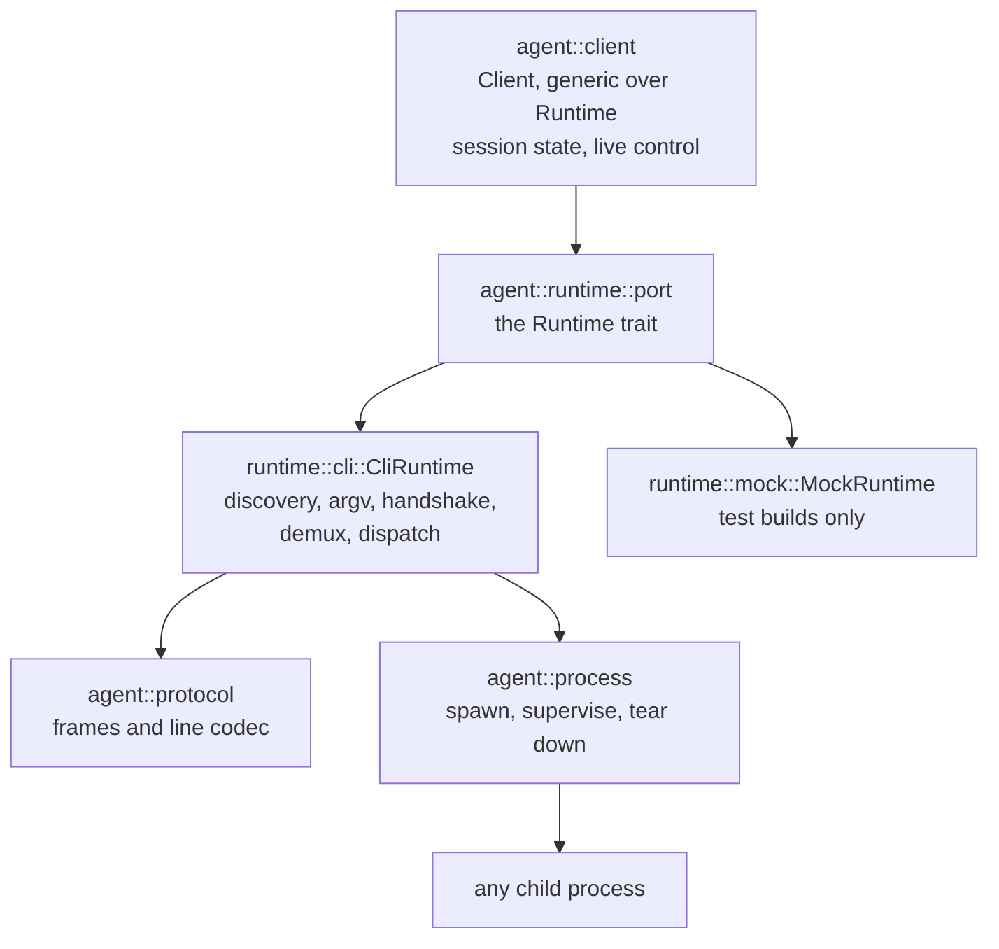
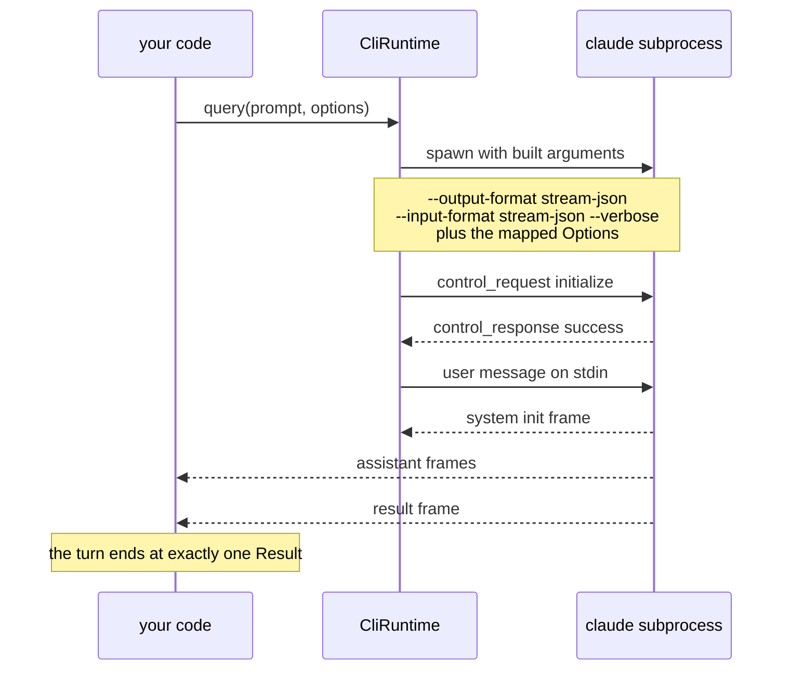
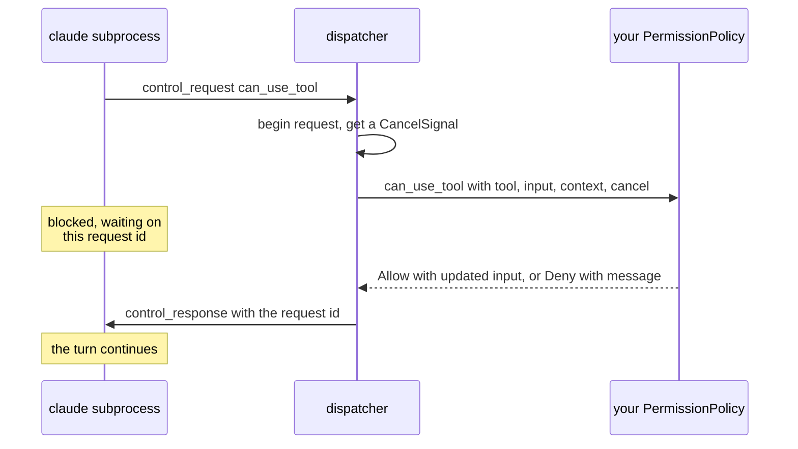

# How the Agent SDK Is Built

This page explains why the Agent SDK is built the way it is. To use it, start at
[the Agent SDK chapter](ch03-00-agent-sdk.md).

## It drives a binary, not an API

The most surprising thing about the Agent SDK is that it does not talk to Anthropic. It starts the
`claude` Code CLI as a subprocess and exchanges newline-delimited JSON with it over stdin and stdout.
Three consequences follow.

**There is no API key.** `agent::Options` has no field for one. The binary already holds credentials,
whether from a subscription login or its own config, and the SDK inherits them. If `claude -p "hi"`
works in your shell, the SDK works.

**The binary owns the agentic loop.** Tool selection, the tool-call cycle, context compaction,
permission prompting and subagent execution all happen inside the subprocess. `airsclaude` configures
that loop and observes it. It does not run it. This is why so much of `Options` becomes a command-line
flag: configuring the agent largely means building the right argument list.

**The target releases on its own schedule.** The `claude` binary is updated independently of this
crate, so it can send a frame or field this release does not know about. Much of the design below
exists to survive that.

## Four layers, each blind upward

`airsclaude::agent` divides into four layers. Each layer knows nothing about the ones above it, and
that ignorance is what lets the top two be tested without a `claude` binary on the machine.



| Layer | Knows about | Deliberately does not know about |
|---|---|---|
| `agent::process` | Pipes, process groups, graceful shutdown, forced kill | That the child is `claude`, or that the bytes are JSON |
| `agent::protocol` | Frame shapes, the line codec | That a process exists |
| `agent::runtime` | The `claude` binary, its arguments, its control protocol | Who consumes the frames |
| `agent::client` | Sessions, turns, live control | How any of it is transported |

Read it from the bottom up.

`agent::process` supervises a child process and nothing else. Its tests drive a purpose-built helper
binary whose flags provoke specific failures: a child that ignores end of input, one that floods
stderr, one that forks a grandchild into the same process group. Proving there are no zombies and no
orphans does not need Anthropic's binary.

`agent::protocol` is a pure function in both directions. Lines in, frames out. Frames in, lines out.
It never touches a file descriptor.

`agent::runtime` is where the two meet. The `Runtime` trait is the only trait boundary between the
layers. `CliRuntime` implements it over a real subprocess. A `MockRuntime` used by the crate's own
tests implements it by replaying canned turns and recording the control calls it received.

`agent::client` is generic over `R: Runtime`, so it is concrete code with static dispatch, and it
runs end to end against the mock.

### Why a trait with one real implementation

There is exactly one production `Runtime`. Why not drop the trait and let `Client` hold a
`CliRuntime`? Because then no session logic could be tested without starting a real agent. A test of
"does a denied permission end the turn correctly" would need a `claude` binary, network access,
credentials and a tolerance for non-determinism. The trait costs one indirection and buys a test suite
that runs anywhere.

`Runtime` carries 23 methods: `run`, plus control and introspection operations. It is also dyn-safe,
which a compile-time check asserts, though nothing stores a `dyn Runtime`. That is cheap insurance, not
a requirement.

## A turn, end to end

This is what happens between `query(...)` and the first frame reaching your code.



Two details are worth pulling out.

The `initialize` request carries the system prompt, any hook declarations keyed by the callback ids the
registry minted, the structured-output config and the session title. `reinitialize` sends the same
body over the live control channel instead of at spawn.

The capability manifest does not come back on that response. It arrives later, on the `system` init
message frame.

## `Options` is fixed at spawn; `Client` is not

Everything on `Options` is decided before the process starts, because most of it becomes command-line
arguments. You cannot change `cwd` or `allowed_tools` on a running agent for the same reason you
cannot change a process's arguments after it starts.

The mid-session equivalents live on `Client`, as control requests sent down the same pipe.
`set_model`, `set_permission_mode`, `toggle_mcp_server`, `set_max_thinking_tokens` and the rest each
send a correlated request and wait for its response. So `Options::model` and `Client::set_model` do the
same thing in two different ways, one at spawn and one over the pipe.

Some `Client` methods cost nothing, because they read the response retained from the handshake:
`supported_models`, `supported_commands`, `supported_agents`, `account_info` and `initialize_result`.
Only `reinitialize` sends the handshake again.

## Exhaustive, with an escape hatch

`agent::Message` is an exhaustive enum, so the compiler will not let you forget a frame kind. It also
has `Message::Other(Value)`, which carries any frame this release does not model.

These sound contradictory and are not. Exhaustiveness is about your code: you cannot silently ignore a
`Result` frame. `Message::Other` is about the binary's code: it can add a frame kind tomorrow, and your
turn still completes, with the raw JSON available to inspect. Without the catch-all, one new field or
frame in a `claude` update would fail every turn with a decode error. With it, the same update is a log
line.

## Your code runs inside the loop

Four traits let Rust take part in the loop instead of watching it. You register them on `Options`, and
the runtime consults them as the turn proceeds.

| Trait | Consulted when |
|---|---|
| `PermissionPolicy` | A gated tool is about to run |
| `Hook` | A lifecycle event fires |
| `Tool`, through `SdkMcpServer` | The model calls an in-process tool |
| `ElicitationPolicy` | An MCP server asks the user for input mid-call |

These are not callbacks the binary invokes. The binary sends an inbound control request down the pipe,
the dispatcher routes it to your handler, and your handler's return value becomes a correlated control
response.



The important part is the note on the left. The dispatcher waits for your handler to finish and only
then writes the response. A `PermissionPolicy` that never returns means the response is never written,
and the binary, which blocks on that response, stalls with it. Put a timeout inside any handler that
could wait on something slow.

### Cancellation is cooperative

A `PermissionPolicy`, a `Hook` and an `ElicitationPolicy` each receive a `CancelSignal`. A `Tool`
receives only its input. If the binary withdraws the request, the signal fires, but
nothing kills your handler. A handler that ignores the signal runs to completion, and its answer is
still written back. A handler that cares checks `is_cancelled()` or awaits `cancelled()` and returns
early. Async work cannot be killed safely mid-execution, and a handler holding a lock or a half-written
file should get to finish or unwind.

This policy checks the signal before it answers. It reaches no service:

```rust
use std::sync::Arc;

use airsclaude::agent::{
    AgentError, CancelSignal, Options, PermissionContext, PermissionDecision, PermissionPolicy,
};
use async_trait::async_trait;

struct ReadOnly;

#[async_trait]
impl PermissionPolicy for ReadOnly {
    async fn can_use_tool(
        &self,
        tool: &str,
        _input: &serde_json::Value,
        _ctx: PermissionContext,
        cancel: CancelSignal,
    ) -> Result<PermissionDecision, AgentError> {
        if cancel.is_cancelled() {
            return Err(AgentError::Protocol {
                detail: "request withdrawn".to_string(),
            });
        }
        Ok(match tool {
            "Read" | "Grep" => PermissionDecision::allow(),
            _ => PermissionDecision::deny("this session is read-only"),
        })
    }
}

# #[tokio::main]
# async fn main() {
// Register it on Options, as a session would.
let options = Options::builder().permission_policy(Arc::new(ReadOnly)).build();
assert!(options.permission_policy.is_some());

// Call it directly, as a unit test of your own policy would.
let decision = ReadOnly
    .can_use_tool(
        "Read",
        &serde_json::json!({}),
        PermissionContext::default(),
        CancelSignal::new(),
    )
    .await;
assert!(decision.is_ok());
# }
```

## Where this leaves parity

Because the binary owns the loop, most of the work of matching the official SDKs is plumbing. An option
becomes the right flag, a frame gets its fields modelled, a control request gets forwarded. That is
tractable, and it is the right shape for a compatibility client. [Appendix C](appendix-03-agent-parity.md)
records what matches and what does not, and [Appendix D](appendix-04-divergences.md) records the places
where `airsclaude` differs on purpose.
