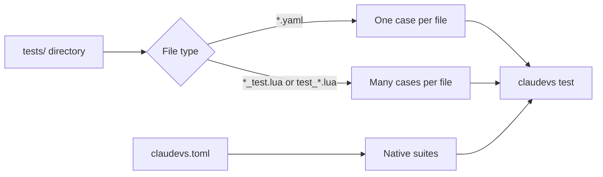

# Writing Cases

A case is a small file that says what one part of your plugin should do. `claudevs test` runs every
case under the plugin's `tests/` directory and reports each one as `ok` or `FAIL`. A case states what
it means, such as "this hook denies the edit", and leaves the exit codes and JSON shapes to claudevs.

These pages assume you have a plugin and have run one case, as in [A First
Plugin](ch05-02-first-plugin.md) and [A First Case](ch05-03-first-case.md). Each page is a set of
recipes, and each recipe carries a small plugin you can type in and run.

| Page | What you write |
|---|---|
| [Hook Decisions](ch06-01-hook-decisions.md) | Cases that check what a hook decides, adds or leaves unsaid |
| [Scripts and Flows](ch06-02-scripts-and-flows.md) | Cases that run a script with an environment, or several steps in one project |
| [Cases in Lua](ch06-03-cases-in-lua.md) | Cases generated in a loop, and cases you script by hand |
| [Native Suites](ch06-04-native-suites.md) | A test command your plugin already has, run next to the cases |
| [Selecting Cases and Reading Skips](ch06-05-selecting-and-skips.md) | Running some cases, and what a `skip` line means |

A case file is found by its name and place. A `.yaml` or `.yml` file under `tests/` is one case, named
by its file stem. A file ending in `_test.lua` or starting with `test_` returns a table of named cases.
Anything under `tests/fixtures/` is data for the cases and is never run as one.

A YAML case runs in a fresh temporary project, so one case cannot change what the next one sees. A Lua
case that calls `t.script` runs its program in the plugin directory unless it passes a `cwd`, so give it
`t.project()` when the program writes files. Each
recipe on these pages is also a directory under
[`crates/claudevs/examples`](https://github.com/airsstack/claudestacks/tree/main/crates/claudevs/examples)
that you can run as it stands. The full list of case fields is in the [claudevs CLI
reference](appendix-01-claudevs-cli.md).
