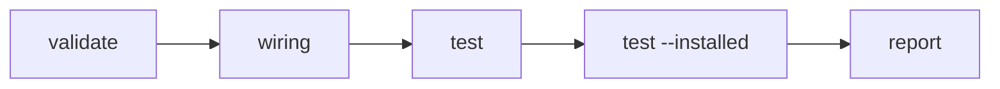

# Stages

By the end of this page you will know why `check` never stops at the first failure, what the second
run of your cases is for, and what `check` does on a machine without `claude`.

## A failed stage does not stop the run

A failed stage does not stop the ones after it. `check` runs validation, wiring, your cases, and your
cases again from the installed layout, then reports all four.

An error is different from a failure. When claudevs cannot judge the plugin at all, `check` stops with
one message and exit code 2 and prints no report. A `hooks/hooks.json` that is not valid JSON while a
hook case runs does this, and so does a case that names a fixture that does not exist. The [exit
codes](appendix-01-claudevs-cli.md#exit-codes) list the rest.



The [`07_wiring_broken`](https://github.com/airsstack/claudestacks/tree/main/crates/claudevs/examples/07_wiring_broken)
example shows why that matters. Its `hooks.json` points at a script that does not exist, so `wiring`
fails. No case exercises that hook, so both runs of the cases still pass.

```console
$ claudevs check --json crates/claudevs/examples/07_wiring_broken | jq -c '.stages[] | {name, status}'
{"name":"validate","status":"passed"}
{"name":"wiring","status":"failed"}
{"name":"test","status":"passed"}
{"name":"test --installed","status":"passed"}
```

Stopping at the first failure would have hidden that the rest of the plugin is fine. It would just as
easily hide a second, unrelated failure in a later stage. One run shows you every problem.

Each stage ends in one of three states: `passed`, `failed` or `skipped`. A skip names something the
machine lacks, such as `claude` or a case file. It never fails the run.

## What the installed layout catches

Claude Code installs a plugin at `cache/<marketplace>/<plugin>/<version>/`, a path with nothing beside
it but the plugin's own files. `test` runs your cases against the plugin where it already sits in
your checkout, which can have other things nearby. `test --installed` copies only the plugin into the
installed shape and runs the same cases again, with `CLAUDE_PLUGIN_ROOT` pointing at the copy.

The two runs catch different defects because they start from different neighborhoods. A hook that
reaches for a file one directory above its plugin root works in a checkout, where that directory
exists. It breaks once only the plugin is copied into place.
[`08_installed_broken`](https://github.com/airsstack/claudestacks/tree/main/crates/claudevs/examples/08_installed_broken)
is exactly that hook.

```console
$ claudevs check --json crates/claudevs/examples/08_installed_broken > report.json
$ jq -c '.stages[] | {name, status}' report.json
{"name":"validate","status":"passed"}
{"name":"wiring","status":"passed"}
{"name":"test","status":"passed"}
{"name":"test --installed","status":"failed"}
$ jq -r '.stages[] | select(.name == "test --installed") | .detail' report.json
  FAIL  blocks-rm-rf
        stderr: expected to contain `blocked-by-policy`, got "cat: /private/var/folders/8w/4ccj7cw90nx4d32s72tqf5nw0000gn/T/.tmp3YuMpF/cache/claudevs-examples/installed-broken/0.1.0/../shared/policy-message.txt: No such file or directory\n\n"
        payload: {"cwd":"/var/folders/8w/4ccj7cw90nx4d32s72tqf5nw0000gn/T/.tmpplvq6y","hook_event_name":"PreToolUse","session_id":"claudevs-test","tool_input":{"command":"rm -rf build","file_path":"/var/folders/8w/4ccj7cw90nx4d32s72tqf5nw0000gn/T/.tmpplvq6y/file.txt"},"tool_name":"Bash"}
        handler: sh "${CLAUDE_PLUGIN_ROOT}/hooks/block-rm-rf.sh"

0 passed, 1 failed (1 cases, 0 native suites)
```

The temporary directory names change on every run, and your paths will differ. The failure itself is
the same: the hook reads `../shared/policy-message.txt`, and the copy has no `shared/` next to it.

`wiring` does not catch this. It reads references written as `${CLAUDE_PLUGIN_ROOT}/…`, with braces,
and this script writes the variable without them. Keep the file inside the plugin and both runs pass.

## Why validation is handed to claude

`claudevs` delegates manifest validation to `claude plugin validate` and does not reimplement it.
Anything the `claude` binary already checks is one less thing `claudevs` has to keep in sync with a
runtime it does not control.

Delegating also lets the stage degrade gracefully. When `claude` is not on the machine, `validate` is
skipped with a reason, and `check` still runs its own stages. Hide `claude` from `PATH` to see it:

```console
$ env PATH=/usr/bin:/bin "$(command -v claudevs)" check crates/claudevs/examples/01_hook_decision
  skip  validate
        cannot run `claude`: No such file or directory (os error 2)
  ok    wiring
        0 errors, 0 warnings
  ok    test
          ok    allows-other-files
          ok    asks-for-secrets
          ok    blocks-env-file
        3 passed, 0 failed (3 cases, 0 native suites)
  ok    test --installed
          ok    allows-other-files
          ok    asks-for-secrets
          ok    blocks-env-file
        3 passed, 0 failed (3 cases, 0 native suites)

3 stages run, 0 failed, 1 skipped
```

This is the human report. Each stage is marked `ok`, `FAIL` or `skip`, and the last line counts the
stages that ran. A skipped stage is not counted as run.

How strict the delegate is stays a separate choice from whether it runs. By default it is lenient, so
a warning such as a missing `author` does not hold back the stages that would catch a real defect.
[Running in CI](ch07-03-ci.md#fail-on-manifest-warnings) shows how to turn those warnings into
failures.
