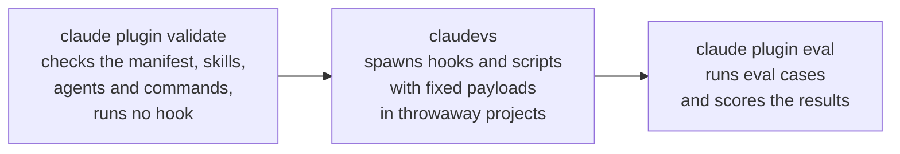

# Why It Works This Way

This page explains three design choices that shape what a claudevs verdict means. To use claudevs, start
at [Getting Started](ch05-00-claudevs-getting-started.md).

## What sits between validate and a live session

`claude plugin validate` checks "a plugin or marketplace manifest, or the skills, agents, and commands
in a directory". That is the tool's own description, from `claude plugin validate --help`. It does not
run a hook.

`claude plugin eval` sits further along. Its help describes it as running eval cases against a plugin
and reporting scored results.

claudevs sits between the two. It spawns a plugin's hooks and scripts the way Claude Code would, but
against fixed payloads in throwaway projects instead of a live session. The throwaway project is there
so the same case gives the same verdict on every run. A live session carries state, and that state would
make today's answer depend on what happened yesterday.



## Cases assert meaning, not mechanics

A case can say `decision: deny` instead of "exit 2" or "print `blocked` on stderr". claudevs owns the
step from an observed run to that meaning. The `expect` block is where a case states what it means.
The harness reads each observed run back into the same vocabulary and compares the two.

```yaml
event: PreToolUse
payload:
  tool_input:
    file_path: .env
expect:
  decision: deny
```

This case passes against any hook that denies edits to a `.env` file. A `PreToolUse` hook that exits 2 denies it. So
does a hook that prints a JSON envelope carrying `permissionDecision: "deny"`. The case does not choose
a mechanism. The hook does, and claudevs reads whichever one it picked.

That is also why a hook can change how it says no without breaking its cases. Moving from an exit code
to an envelope changes the mechanism and leaves the meaning where it was.

[Appendix A](appendix-01-claudevs-cli.md#how-a-hook-run-is-read) lists the shapes claudevs reads.

## Why cases cover fewer events than hooks.json may use

Two lists answer two different questions about a hook event.

One catalogues every event Claude Code documents. It is the full set a plugin may legitimately wire in
`hooks.json`, and the wiring checks read it.

The other lists only the events claudevs can build a payload for and read a hook's response to. A case
can use only these five: `PreToolUse`, `PostToolUse`, `UserPromptSubmit`, `SessionStart` and
`SessionEnd`.

The second list is narrower, so a plugin may wire an event that claudevs cannot run a case against. The
gap is not a defect in either list. A documented event and a runnable event are not always the same
event. A checker that reads `hooks.json` has to consult the wider catalogue, and a case has to work
within the narrower one.

For a plugin author the effect is simple. A wiring check can accept an event that no case can exercise,
because claudevs cannot run it.
