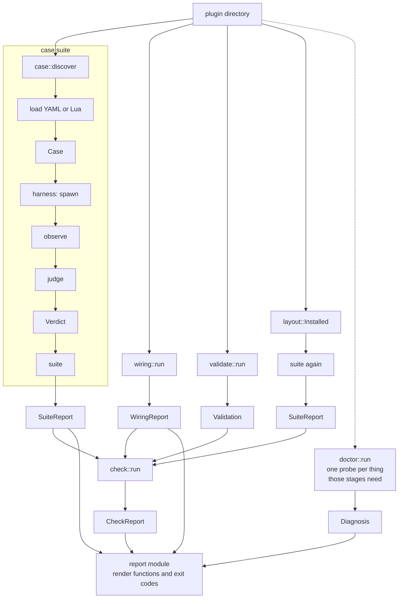
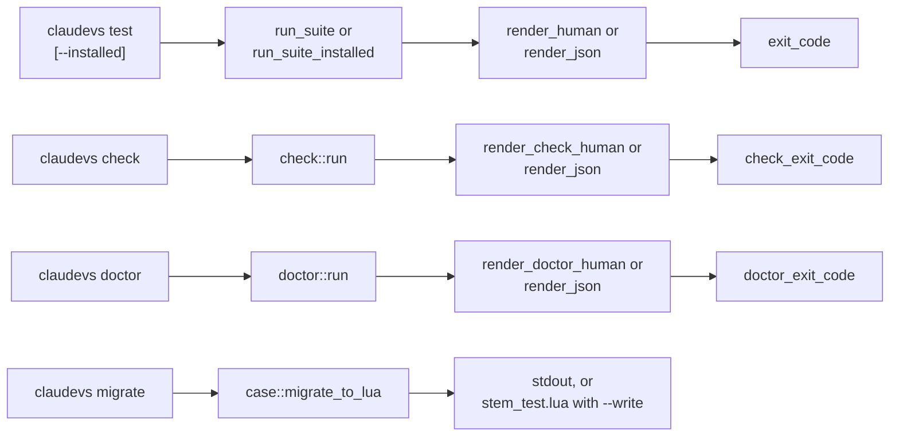

# How the Engine Fits Together

This page explains how the parts of claudevs relate. It is written for a Rust caller of the engine. To
call the engine, start at [Embedding](ch08-00-embedding.md). For why the harness judges meaning rather
than mechanics, see [Why It Works This Way](ch09-01-design.md).

## Two crates

`claudevs-cli` builds the `claudevs` binary. It is the only one of the two crates that depends on
`clap`. Its command-line grammar and dispatch live in one file, and nothing else parses arguments.

`claudevs` is the engine that binary calls. Everything the binary does, from running a suite to
rendering a report, is a call into a public function this crate exports.

## Module map

Nine of the engine's modules are public. The private ones carry the pieces below, and you reach them
through the crate root's re-exports.

| Module | Visibility | What it offers you |
|---|---|---|
| `case` | public | The case model (`Case`, `CaseKind`, `Expectations`, `Step`, `Invocation`) and the ways to get one: `discover` finds case files, `load_yaml_case` and `load_lua_file` read them, `run_lua_file` runs a Lua file, and `migrate_to_lua` converts a YAML case. |
| `check` | public | `run`, the one gate a plugin passes or fails. It returns a `CheckReport` made of `Stage` values. |
| `contract` | public | What Claude Code specifies about plugin hooks: the event catalogue (`catalogue`, `lookup`), how a `matcher` value is evaluated (`MatcherRule`), the `hooks.json` handler (`HookCommand`) and which plugin files Claude Code loads. |
| `doctor` | public | `run`, which reports what this environment can and cannot do as a `Diagnosis` of `Probe` values. |
| `harness` | public | The execution harness. It builds default payloads, spawns hooks and scripts the way the runtime would (`run`, `run_shell`, `run_handler`), reads a run (`observe`) and judges it (`judge`, `Verdict`, `Mismatch`). |
| `layout` | public | `Installed::materialize`, which copies a plugin into the shape it has once installed, and `read_manifest` for its `plugin.json`. |
| `types` | public | Validating newtypes for domain values: `CaseName`, `MarketplaceName`, `PluginName`, `PluginVersion`, plus `HookEvent`. |
| `validate` | public | `run`, which hands a plugin to `claude plugin validate` and returns a `Validation`. |
| `wiring` | public | `run`, the static wiring checks. It returns one `WiringReport`. The three checkers are public submodules: `refs`, `invocations` and `matchers`. |
| `error` | private | The crate's `Error` and `Result`. |
| `native` | private | Native suites a plugin declares outside the case model, in `claudevs.toml`. |
| `report` | private | Rendering a report for people and for machines, and the exit codes. |
| `suite` | private | Running a plugin's suite: discovery, per-case execution, report data. |

The crate root re-exports what you need from the private modules, so you never name their paths:

- from `check`: `CheckReport`, `Stage` and `StageStatus`
- from `doctor`: `Diagnosis`, `Probe` and `ProbeStatus`
- from `error`: `Error` and `Result`
- from `harness`: `Mismatch` and `Verdict`
- from `native`: `NativeOutcome`
- from `report`: `Report`, `check_exit_code`, `doctor_exit_code`, `exit_code`, `render_check_human`,
  `render_doctor_human`, `render_human`, `render_json` and `render_wiring_human`
- from `suite`: `CaseOutcome`, `SuiteOptions`, `SuiteReport`, `run_case`, `run_suite` and
  `run_suite_installed`
- from `validate`: `Strictness` and `Validation`
- from `wiring`: `Finding`, `Severity` and `WiringReport`

## From a plugin directory to a report

A plugin directory goes in. Each stage turns it into a report. The `check` gate runs four of them, and
`doctor` runs one probe for each thing those stages need.



The `report` module turns any of these results into human text, JSON or an exit code.

The binary wraps each entry point in one subcommand:



## One type means a test case

YAML files and Lua data tables both deserialize into `RawCase` and become a `Case` through
`Case::from_raw`. Nothing else in the crate models a case. A case is one of three kinds: hook, script
or flow.

Expectations state meaning, such as `decision: deny`. The harness owns the translation from a run into
that meaning. A case never asserts an exit code where a decision is what it means.

## The harness spawns, observes, then judges

A hook command without `args` runs through `sh -c`. A hook command with `args` is spawned directly. A
script's argv is always spawned directly. Every spawn carries a 30-second timeout, and a killed child
is never a pass.

`observe` reads a run under its event's rules. `judge` compares that observation with the case's
expectations and lists every mismatch rather than stopping at the first. A YAML case runs in a
temporary project. A Lua case that calls `t.script` runs in the plugin directory unless it passes a `cwd`.

## A failing plugin is a verdict, not an error

`Error` means claudevs itself could not produce a verdict. A case file that does not load is one
example. A fixture that a case names but that is not there is another. The rustdoc lists the full set.

A plugin that fails its own cases is not an `Error`. It is a `Verdict` with mismatches in it.

## Wiring reads files and never runs them

The three wiring checkers answer static questions about a plugin's files without spawning anything the
plugin ships. They ask whether a reference resolves, whether a script is named by anything, and whether
a matcher is one claudevs can evaluate.

## validate and layout reach outside the plugin

`validate` hands the plugin to `claude plugin validate` instead of repeating the manifest checks that
command already makes. It reports `Unavailable` when `claude` cannot run at all.

`layout` builds the installed copy that the second suite stage runs its cases against.

## check and doctor compose the rest

`check` runs the four stages a plugin's gate needs. `doctor` runs one probe per thing those stages
need, so a gap it reports is exactly what would make a stage skip or fail.

## Reports are data first

Human text and JSON both come from the same report structs. The sealed `Report` trait limits
`render_json` to the crate's own report types rather than any `Serialize` value. The set of report
types can grow, so do not depend on how many there are.

## Two lists of hook events

`types::HookEvent` lists the events a case can run against. `contract::event` catalogues the events
Claude Code documents, which the wiring checkers read. The two are separate on purpose. A documented
event claudevs cannot simulate is still one a plugin may legitimately wire. [Why It Works This
Way](ch09-01-design.md#why-cases-cover-fewer-events-than-hooksjson-may-use) explains the reasoning.

## What `#[non_exhaustive]` means for a caller

Every public type carries `#[non_exhaustive]` except these:

- the validated newtypes in `types`: `CaseName`, `MarketplaceName`, `PluginName` and `PluginVersion`
- the error structs of those newtypes
- `InvalidHookEvent`
- `case::Invocation`
- `harness::TModule`

Name them rather than counting them.

A caller cannot build such a struct with a literal. Start from `Default` where one exists and set the
fields from there:

```rust
let mut options = claudevs::SuiteOptions::default();
options.case_filter = Some(String::from("blocks"));
assert_eq!(options.case_filter.as_deref(), Some("blocks"));
```

A `match` on such an enum needs a wildcard arm. A variant the crate adds later must not become a
compile error at every call site:

```rust
use claudevs::StageStatus;

fn mark(status: StageStatus) -> &'static str {
    match status {
        StageStatus::Passed => "ok",
        StageStatus::Failed => "FAIL",
        StageStatus::Skipped => "skip",
        _ => "?",
    }
}
assert_eq!(mark(StageStatus::Skipped), "skip");
```
