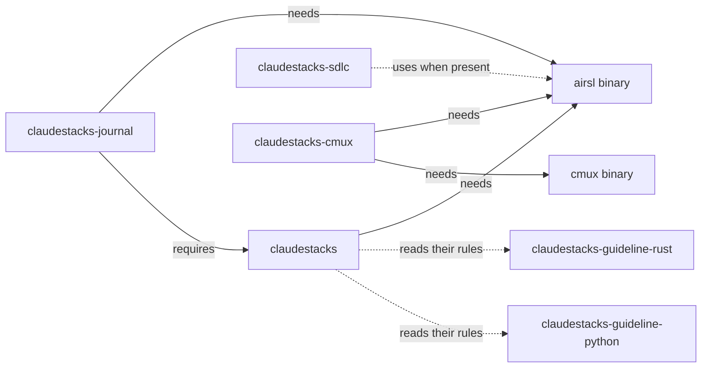

# Getting Started

The plugin suite is six plugins for [Claude Code](https://www.claude.com/product/claude-code). They
come from one marketplace, and you install only the ones you want. This page shows what each plugin
is for, what it needs on your machine, and how to install it. Each plugin then has its own chapter.

| Plugin | What you get | Chapter |
|---|---|---|
| `claudestacks` | Three agents (`coder`, `reviewer`, `explorer`), an `orchestrate` skill that drives them, snapshot memory, `/claudestacks:discuss` and a status line | [claudestacks](ch11-00-claudestacks-plugin.md) |
| `claudestacks-sdlc` | A workflow that carries an idea from intent to spec to plan to finished work, with a status board | [claudestacks-sdlc](ch12-00-sdlc-plugin.md) |
| `claudestacks-guideline-rust` | Rust rules and a Definition of Done the agents check against | [Guidelines](ch13-00-guideline-plugins.md) |
| `claudestacks-guideline-python` | Python rules and a Definition of Done the agents check against | [Guidelines](ch13-00-guideline-plugins.md) |
| `claudestacks-journal` | An Obsidian-compatible journal that Claude writes and recalls from | [claudestacks-journal](ch14-00-journal-plugin.md) |
| `claudestacks-cmux` | Control of the [cmux](https://cmux.com) terminal | [claudestacks-cmux](ch15-00-cmux-plugin.md) |

## What each plugin needs

Most of the hooks and scripts in these plugins are written in Lua and run on `airsl`, a separate
binary. Four plugins use it. Two plugins need something more.



The guideline plugins have no hooks and no scripts, so they need nothing at run time. The
`claudestacks` plugin reads their `enforcement.json` files and points Claude at the right guideline
when it reads or edits a matching file. The `claudestacks-sdlc` plugin works without `airsl`, but its status
board and its session-start summary come from `airsl`. Without it, Claude works the board out by hand.

`claudestacks-journal` declares `claudestacks` as a dependency in its manifest. Its review command
calls the `context-handoff` skill from that plugin, so install `claudestacks` first.

## Install airsl

Install `airsl` before the plugins. Without it, every hook that runs on it exits without doing
anything and without an error.

```bash
curl -LsSf https://airsstack.github.io/airsl/install.sh | sh
```

That downloads a prebuilt binary and needs no Rust toolchain. To build it from source instead:

```bash
cargo install airsl-cli --locked
```

The `claudestacks` plugin also carries a script, `scripts/install-airsl.sh`, that tries the prebuilt
installer first and falls back to `cargo install airsl-cli --locked` if that cannot run or does not
complete. Its `--force` flag applies to the cargo route only. It reports where the binary was installed and warns
when that directory is not on `PATH`.
When `airsl` is missing, the plugin's session-start check puts a notice in the session's context that
names the hooks switched off and prints the exact path of that script.

No route pins a version, and the script does not skip when a binary is already present. Running any of
them again installs the latest `airsl`.

When it is installed, the version prints:

```bash
airsl --version
```

```text
airsl 0.1.2
```

Your version may differ from the one printed here.

## Install the plugins

Add the marketplace once, then install what you want. These are commands for a Claude Code session,
so this page shows no output for them.

```text
/plugin marketplace add airsstack/claudestacks
/plugin install claudestacks@claudestacks
/plugin install claudestacks-sdlc@claudestacks
/plugin install claudestacks-guideline-rust@claudestacks
/plugin install claudestacks-guideline-python@claudestacks
/plugin install claudestacks-journal@claudestacks
/plugin install claudestacks-cmux@claudestacks
```

Until a skill is used, at most its description sits in Claude's context. The full text loads when the
skill runs.

Every skill is named after its plugin. A skill called `snapshot-save` in `claudestacks` runs as
`/claudestacks:snapshot-save`. A skill called `status` in `claudestacks-sdlc` runs as
`/claudestacks-sdlc:status`. The chapters write each skill in that full form.

## When a hook cannot find airsl

Every hook that runs on `airsl` looks for the binary in this order and uses the first match:

1. The path in the `AIRSL_BIN` environment variable, if it names an executable file.
2. `airsl` on `PATH`.
3. `~/.local/bin/airsl`.
4. `$CARGO_HOME/bin/airsl`, with `CARGO_HOME` defaulting to `~/.cargo`.
5. `~/.cargo/bin/airsl`.

The last three mean a binary in either install location is found even when that directory is not on
`PATH`. If `airsl` is installed somewhere else, set `AIRSL_BIN` to the binary's full path.

Skills that run `airsl` themselves, such as the status line installer and the journal's commands, call
it by name, so for those the directory must be on `PATH`. The install script warns when it is not.

## Working in the repository

Inside the claudestacks repository, `.claude/settings.json` already registers the marketplace. You
enable plugins with `/plugin` and do not need the `marketplace add` command.

## Where to go next

Start with [claudestacks](ch11-00-claudestacks-plugin.md): the other plugins build on its agents and
its hooks. If you want the workflow that carries a change from an idea to reviewed code, read
[claudestacks-sdlc](ch12-00-sdlc-plugin.md).
