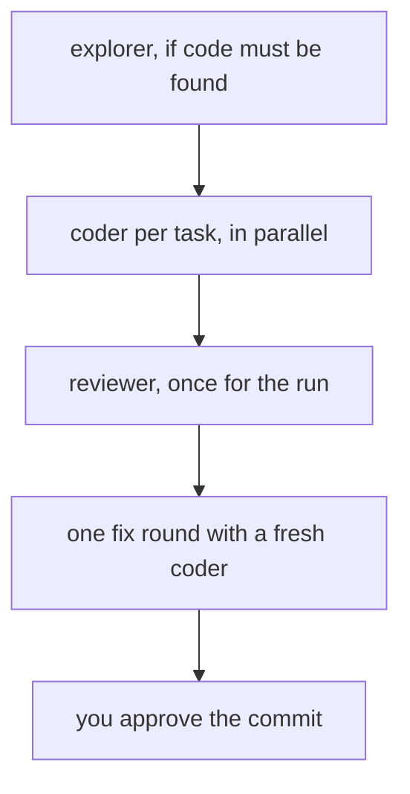

# claudestacks

`claudestacks` is the core plugin of the suite. It gives Claude Code three agents and a skill that
runs them in order, so a task is coded, checked and reviewed before it reaches you. It also holds the
suite's hooks: reply rules, project memory and the dispatcher that points Claude at the right
guideline.

It works on any language. The agents take their rules and their Definition of Done from whichever
guideline plugin you have installed, such as the [Rust or Python guidelines](ch13-00-guideline-plugins.md).

[Install `airsl` and the plugin](ch10-00-plugins-getting-started.md) first. Everything here is
namespaced `claudestacks:`, so a skill called `discuss` runs as `/claudestacks:discuss`.

## Agents

Each agent fixes its model and effort in its own definition.

| Agent | Model and effort | Role |
|---|---|---|
| `claudestacks:coder` | sonnet, high | Does one scoped task test-first, runs the Definition of Done from the active guideline, and leaves the changes in the working tree. It never commits. |
| `claudestacks:reviewer` | opus, high | Runs the Definition of Done itself, reviews the diff for correctness and against the guideline, and checks the work against what the task asked for. It writes a report and changes nothing. |
| `claudestacks:explorer` | haiku, low | Answers "where is X" with `file:line` tables. It refuses to judge or to suggest fixes. |

An agent never starts another agent. The order they run in comes from the `orchestrate` skill.

Both `coder` and `reviewer` load the guideline skill for your language when they start. With none
installed, `coder` says so and asks you for the quality bar. `reviewer` then reviews for correctness
only and says the stack rules were unavailable.

## Skills

| Skill | What it does |
|---|---|
| `/claudestacks:orchestrate` | Runs `explorer`, `coder` and `reviewer` in order for a task, and holds the commit gate for you. |
| `/claudestacks:context-handoff` | Decides where agent reports are written, so detail stays on disk and only a summary reaches the conversation. |
| `/claudestacks:process-guidelines` | Conventional Commits with workspace-aware scopes, model routing for delegated work, and the order agents run in. |
| `/claudestacks:discuss` | Opens a discussion where agent detail waits behind numbered topics. You type it; Claude does not start it. |
| `/claudestacks:snapshot-save` | Saves a short snapshot of the session to a store outside the repository. |
| `/claudestacks:snapshot-load` | Reads the saved snapshots back and reports where the work stands. |
| `/claudestacks:enforce-doctor` | Explains why a guideline pointer did or did not appear for a file. |
| `/claudestacks:statusline` | Installs, checks or removes a status line for Claude Code. You type it; Claude does not start it. |

### The orchestrate pipeline

`orchestrate` runs on the main conversation, because the agents cannot chain themselves. It cuts the
work into batches of tasks that touch different files, and it builds each batch in parallel with one
`coder` per task.



The `reviewer` runs once, after every task is done. It does not run for each task or each batch. Its
findings go back through `orchestrate` to a fresh `coder` for one fix round, and the `reviewer` does
not look at the fixed diff again. Nothing is committed until you say so.

### The status line

`/claudestacks:statusline` points Claude Code's `statusLine` setting at a two-line status line. It
shows the path, git branch, context meter, output tokens, model and rate limits.

The skill asks which scope you want. Global copies the status line into `~/.claude/statusline/` and
edits `~/.claude/settings.json`. Project edits `.claude/settings.local.json` and points at the plugin's
files in place. It first reports what it would change, backs up the settings file before it writes,
and refuses to replace a `statusLine` that it did not install. It needs `airsl`.

## Hooks

The hooks add context to a session and check agent reports. The ones that run on `airsl` exit
silently when it is missing.

| When | What runs |
|---|---|
| Session start, resume or `/clear` | A reminder to run `/claudestacks:snapshot-load`. If `airsl` is not found, a notice that names the switched-off hooks and the install command follows. |
| Session start after compaction | Clears the markers that stop the guideline pointer from repeating, so it can appear again. |
| Every session start | The reply rules, described below. |
| Every prompt | The reply rules again, unless you turn that off. |
| Session end | A reminder to run `/claudestacks:snapshot-save`. |
| Before Claude reads, edits or writes a file | The enforcement dispatcher, described below. |
| An agent writes a report, hands one back or stops | A check that the report follows the report format, and a second check for reports written under `/claudestacks:discuss`. |

The session hooks only nudge. Claude decides whether a snapshot is worth loading or saving.

### The reply rules

The reply rules are four short instructions that make Claude's answers brief, and three lines on how to
apply them. They come from the `## Reply rules` section of the `discuss` skill's protocol file:

1. Reduce agent verbosity output.
2. Do not over-explain everything; only explain what matters.
3. Use ASCII visualizations to replace long narratives or text.
4. Be concise but precise; only tell what matters and is important.

Applied as:

- The outcome comes first.
- Anything that would run past a short paragraph becomes an ASCII diagram, table or tree.
- While a discussion is open, a reply ends with its topic list.

### Options

The plugin declares two options. Claude Code asks for them when you enable the plugin, and they
appear in `/config`.

| Option | Default | What it does |
|---|---|---|
| `style_reinject` | on | Sends the reply rules with every prompt. When it is off they are still sent at every session start, `/clear` and compaction. |
| `archive_keep` | 20 | How many other `/claudestacks:discuss` discussions to keep for the project besides the current one. Older ones are removed when a new one starts. |

## Discussions

`/claudestacks:discuss` is for work where agents would otherwise flood the conversation. While a
discussion is open, agents you brief hand back a summary of at most six lines and a numbered list of
topics. The detail stays in a file until you open a topic.

```text
/claudestacks:discuss
/claudestacks:discuss 2
/claudestacks:discuss list archive
/claudestacks:discuss done
```

- With no argument it opens the discussion for this session.
- A number opens one topic of the current discussion, and `<sid8>/<number>` opens a topic of an earlier
  one. `list archive` prints those ids.
- `list` shows the current topics, and `list archive` shows the topics of the other discussions.
- `done` closes the current discussion.

While it is open, every reply ends with the topic list. Discussions are stored under
`${AIRSSTACK_HOME:-~/.airsstack}/discussions/<project-key>/`, one directory per session. The project
key is the same one snapshots use, described next.

## Project snapshots

`/claudestacks:snapshot-save` writes a short snapshot of the session: a summary and a few key
snippets, in one timestamped file. A thin session, or one whose content is already in the repository,
writes nothing. The store is outside the repository:

```text
${AIRSSTACK_HOME:-~/.airsstack}/snapshots/<project-key>/
├── index.md
├── 2026-06-15-143012-feature-memory.md
└── 2026-06-14-090530-main.md
```

The project key is the repository's name and eight characters of a hash of its shared `.git`
directory, such as `claudestacks-3f9a2c1b`. It comes from `git rev-parse --git-common-dir`, so all
worktrees of one repository share one store. The snapshots survive worktree removal, branch changes,
a `target/` clean and `/clear`. Because they live outside the repository, they cannot be committed by
accident, and they do not travel to a teammate, to CI or to a fresh clone. Project knowledge that
others need belongs in committed source, such as docs.

The store is separate from Claude's own memory tool. These skills never write there, and the index is
named `index.md`, never `MEMORY.md`. Each save adds one line to `index.md`.

### Saving and loading a topic

Both skills take an optional topic. Saving tags a focus, and loading matches it across branches.

| Command | What it does |
|---|---|
| `/claudestacks:snapshot-save` | Saves the session as a whole. |
| `/claudestacks:snapshot-save streaming parser` | Focuses the summary and snippets on *streaming parser*, and records that topic in the file and in `index.md`. |
| `/claudestacks:snapshot-load` | Loads the latest snapshots for the current branch. |
| `/claudestacks:snapshot-load streaming parser` | Searches the snapshots of every branch for the topic. It matches the saved topic first, then the summary, and uses the branch only to break ties. If nothing matches, it says so. |

Use a topic when one session covered a thread you will want to resume on its own, possibly from
another branch. Save `retry backoff` on a spike branch, and weeks later `/claudestacks:snapshot-load
retry backoff` on `main` brings back that thread without the rest of the spike. A snapshot saved
without a topic is still found: the search falls back to its summary.

## The enforcement dispatcher

The dispatcher reminds Claude to load the right guideline when it works on a file. A hook runs before
Claude reads, edits or writes a file. It looks at every plugin installed from the `claudestacks`
marketplace, and for each one it reads `enforcement.json` at the plugin's root. When a file matches, it
adds a short instruction to the conversation: the named skill is mandatory for this work, so load it and
apply its rules.

The hook only adds context. It never blocks or defers a tool call. It reads the registry at
`~/.claude/plugins/installed_plugins.json`; setting `AIRSSTACK_ENFORCE_REGISTRY` points it at another
file. It runs under `airsl`, and without `airsl` it does nothing.

### The enforcement.json file

A plugin that wants its rules surfaced puts one file at its root and ships no enforcement hook of its
own, because this dispatcher is the hook that reads the file. This is the Rust guideline plugin's:

```text
{
  "stack": "rust",
  "detect": ["Cargo.toml"],
  "match": ["**/*.rs", "**/Cargo.toml"],
  "skill": "claudestacks-guideline-rust:rust-guidelines",
  "phase": ["code", "design"]
}
```

| Field | Meaning |
|---|---|
| `stack` | The name of the rule set. It is also part of the key that stops the pointer from repeating. Required. |
| `skill` | The skill the instruction tells Claude to load. Required. |
| `detect` | Marker files. The stack is active when one sits in the anchor directory or any directory above it. |
| `match` | Path patterns that select the files the code phase fires for. |
| `phase` | Which phases fire: `code`, `design`, or both. When it is missing or empty, both. |

A `match` pattern understands `*` and `?`, which stop at a `/`, a `**/` anywhere in the pattern that covers zero or
more directories, a `**` that crosses directories, and `[...]` character classes. It does not understand
brace alternation such as `*.{rs,toml}`. A pattern that cannot be compiled is skipped and the others
still apply.

### The three gates

A file has to pass three gates before the pointer appears.

1. **Project binding.** The plugin's registry record must belong to this project, or be a record that
   names no project. A plugin installed only for one repository adds nothing in another.
2. **Activation.** A `detect` marker must sit at or above the directory of the file being touched, so
   a `.rs` file with no `Cargo.toml` above it does not fire. For the design phase the anchor is the
   working directory instead.
3. **Selection.** A `match` pattern must hit the file's path relative to the repository root. A file
   outside any repository is matched by its file name alone.

Each stack and phase fires once per session for each agent context, so the main conversation and each
subagent get their own pointer. The markers that record this are files named
`claudestacks-enforce-…` in `$TMPDIR`, or `/tmp` when that is unset. A marker older than a day is
removed. After a compaction the hook clears the session's markers, so the pointer can appear again.

### Code and design

The `code` phase fires for source files that pass the three gates. The `design` phase fires for a
document under `${AIRSSTACK_HOME:-~/.airsstack}/cc/plugins/sdd/<project-key>/specs/` or `plans/`. It
skips the `match` gate, and it asks Claude to apply the architecture rules, not the Definition of
Done, since a design has nothing to build. The [`claudestacks-sdlc`](ch12-00-sdlc-plugin.md) plugin
keeps its documents in your repository under `.claudestacks/sdlc/`, not in that directory.

Enforcement has two tiers. This hook makes the rule visible when it applies. Later, the `reviewer`
agent re-runs the Definition of Done and checks the result. The dispatcher fails open: a missing
registry, a missing or malformed `enforcement.json` and a missing runtime all end in no pointer,
never in a blocked edit.

### Finding out why it stayed quiet

Because failing open looks the same from outside in several different cases, the plugin includes a
diagnostic. Give it a file path:

```text
/claudestacks:enforce-doctor crates/claudevs/src/lib.rs
```

It runs the same resolution as the hook with a trace attached and reports the outcome and the stage that
ended it. Among the stages it can name are:

- there are no `claudestacks` plugins in the registry;
- no plugin has a usable `enforcement.json`. Only the guideline plugins ship one, so this is expected
  when neither is installed, even though the report calls it a delivery failure. With one installed,
  its files may not have reached the cache;
- gate 1, 2 or 3 stopped it;
- the pointer already fired in this context, which is expected.

It also shows which registry record each plugin resolved to. Inside the claudestacks source repository
it compares each plugin's source files with its installed copy and lists any file that is missing from
the cache or differs from the source. The diagnostic keeps its own session identity, so running it twice
on one path reports the second as already fired, because it sees the marker its first run set.
