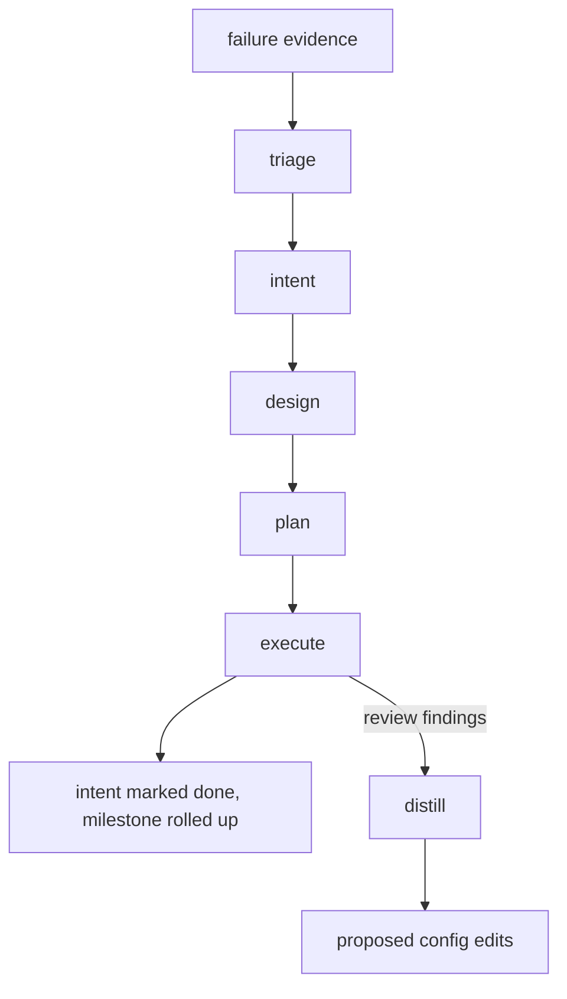

# claudestacks-sdlc

`claudestacks-sdlc` carries a change from an idea to reviewed code in four steps: intent, design,
plan, execute. Each step leaves its result in a committed Markdown file. A status board reads those
files and tells you which step is next. It follows Anthropic's
[AI-native SDLC playbook](https://claude.com/blog/the-ai-native-sdlc-playbook) at the scale of one
author. Roadmaps, milestones and architecture decision records (ADRs) are optional layers above the
chains.

[Install the plugin](ch10-00-plugins-getting-started.md) first. Every skill is namespaced
`claudestacks-sdlc:`, so the `design` skill runs as `/claudestacks-sdlc:design`. Some steps use the
agents from [claudestacks](ch11-00-claudestacks-plugin.md), which you should install too.

The marketplace does not carry an older plugin named `claudestacks-sdd`. If you still have it installed,
remove it. This is a command for a Claude Code session, so there is no output to
show.

```text
/plugin uninstall claudestacks-sdd@claudestacks
```

## The flow



`intent` and `design` are the two steps that talk with you, and `design` proves each claim it writes
down. `plan` asks one question, whether to accept the whole set. `execute` asks nothing: it never asks, never
re-proves and never refuses. When something is unclear it makes a call and records it in the plan's
`## Deviations` section, then reports once at the end.

Two loops feed back into the chain:

- **Failure evidence.** `triage` turns a log, an advisory or a backtrace into a draft intent.
- **Repeated findings.** `distill` reads the review findings of every chain. When the same category
  appears in two or more different chains, it proposes one edit to your project's guidance.

## Skills

| Skill | What it does |
|---|---|
| `/claudestacks-sdlc:intent` | Captures a problem as an intent, or converts a PRD or RFC into one. Also approves, amends, drops or restores an intent. It can mark the chain `spec: skipped`. |
| `/claudestacks-sdlc:design` | Turns an approved intent into `spec.md`. It asks one question at a time and proves each claim with a run or a citation before the spec is approved. |
| `/claudestacks-sdlc:plan` | Turns an approved spec into numbered plan files with files, order of work, risks and named tests. It writes no code and asks once for the whole set to be accepted. |
| `/claudestacks-sdlc:execute` | Builds a plan with `coder` and `reviewer` agents, appends `## Review findings` and `## Deviations`, and marks the plan `done` when every task completes. |
| `/claudestacks-sdlc:distill` | Proposes agent-config edits from findings that recur across chains. You accept, edit or skip each one. |
| `/claudestacks-sdlc:triage` | Turns failure evidence into a draft intent marked `source: triage`. You run it by hand. |
| `/claudestacks-sdlc:roadmap` | Creates, approves, amends, drops or restores a roadmap. |
| `/claudestacks-sdlc:milestone` | Adds, approves, amends, drops or restores a milestone. It also parks scope, adopts or releases a chain, and rolls finished work up. |
| `/claudestacks-sdlc:adr` | Writes an ADR or changes its status. It is the only skill that does either. |
| `/claudestacks-sdlc:status` | Prints the board. It is read-only. |
| `/claudestacks-sdlc:setup` | Creates the `.claudestacks/sdlc/` folder. You type it; Claude does not start it. |

`execute` runs the plan you name, whatever the board says. A board warning is copied into the plan's
`## Deviations` and the run goes on. It works on a new branch named `sdlc/<chain>-<NN>` when you start
on `main` or `master`. It never commits, merges or pushes unless you told it to.

## Agents

Three agents do the mechanical reading, so large files stay out of your conversation. None of them can
start another agent, change a status or commit.

| Agent | Model and effort | What it does |
|---|---|---|
| `claudestacks-sdlc:chain-reader` | haiku, low | Pulls one named section out of many chain files and returns it word for word. |
| `claudestacks-sdlc:artifact-reviewer` | opus, high | Reviews a draft spec, plan set or ADR and returns severity-tagged findings. It reports and never edits. |
| `claudestacks-sdlc:task-briefer` | sonnet, low | Lists the tasks of a plan, or writes one task's full text to a file, so the plan never enters the main conversation. |

`design` and `plan` call `claudestacks:explorer` to locate code. When it cannot answer, they do the
search themselves and say so. `execute` builds with `claudestacks:coder` and `claudestacks:reviewer`.
All three come from the core plugin.

## Where the files live

Everything sits under `.claudestacks/sdlc/` in your repository and is committed. Nothing is deleted:
a replaced file is marked `superseded` or `dropped`, and a replaced spec is renamed with its date.

```text
.claudestacks/sdlc/
├── prds/  rfcs/                          # optional input folders, read-only to the plugin
├── roadmaps/<name>/roadmap.md, NN-*.md   # optional roadmap and its milestones
├── adrs/NNNN-<topic>.md                  # optional, one series for the repository
├── REVIEW.md                             # review policy for code diffs
└── 2026-08-24-webhook-reliability/       # one chain = one intent
    ├── intent.md
    ├── spec.md                           # absent until design runs; may be skipped
    └── plans/01-retry-core.md            # NN orders the plans
```

A chain folder is named `YYYY-MM-DD-<topic>`, dated the day its intent was written. The `setup` skill
creates `prds/`, `rfcs/` and `REVIEW.md` and leaves anything that exists alone. The other skills create
what they need when they first write, so you can start without running `setup`.

`REVIEW.md` is a review policy for code diffs: the order of the passes, the two severities and what
closes a review. No agent reads it on its own. You can point a reviewer at it or paste it into a review
prompt.

## States

Every chain file opens with a `status` line in its frontmatter. A skill changes it only as the last step
of the interaction that earns the change.

| Artifact | States |
|---|---|
| Intent | `draft`, `approved`, `done`; `dropped` from any state |
| Spec | `draft`, `approved`, `superseded` |
| Plan | `draft`, `approved`, `executing`, `done`; `superseded` |

You approve an intent and a spec yourself. Accepting a plan set approves every plan in it together.
Running `execute` on a draft plan approves it. The plan moves to `executing` when the build starts and
to `done` when every task completes. The intent becomes `done` when the board shows the chain complete.

## The status board

Run the board at any time:

```text
/claudestacks-sdlc:status
```

It prints one row per open chain with three columns: the chain, its state, and the next step. A chain
with a draft intent shows `approve or drop`, one with an approved intent and no spec shows `design`,
and a chain with an approved plan shows `execute 01`. When roadmaps exist, rows are grouped under their
milestones and a count shows how many chains are done.

The board checks that the files agree. Every spec and plan records a `built-on` fingerprint, which is
the first twelve characters of the SHA-256 of the file it was written from, with the frontmatter
left out. When the source text changes, the row reads `spec stale (intent changed)` and the next step
is to design again. When a plan's execution showed a claim in its spec to be wrong, the plan records
that, and the row reads `spec disproven by plan 02`. A chain that cannot be read shows
`INVALID (…)` with the reason, and the next step is `fix <chain>`.

The board comes from a script that runs on `airsl`. Without `airsl`, the `status` skill makes Claude work
the board out by hand from the same rules.

At every session start a hook prints a short summary, such as
`claudestacks-sdlc: 2 open, 0 need attention — full board: /claudestacks-sdlc:status`, followed by the rows that need a look: invalid, stale, blocked and disproven chains, chains
that are complete, and plans that are executing. It says nothing when there is no
`.claudestacks/sdlc/` folder. It needs `airsl`.

Every path, state and board rule is written out in the plugin's
[`references/artifact-chain.md`](https://github.com/airsstack/claudestacks/tree/main/plugins/claudestacks-sdlc/references/artifact-chain.md), and the shape of
each file is in [`references/templates.md`](https://github.com/airsstack/claudestacks/tree/main/plugins/claudestacks-sdlc/references/templates.md).

## Roadmaps, milestones and ADRs

These are optional. A chain without a milestone is a simple chain, and nothing requires a roadmap.

- A **roadmap** is one file naming a direction. Its **milestones** are numbered files beside it. A chain
  joins a milestone through a `milestone: <roadmap>/<NN>` line in its intent. Neither records progress.
  The board counts it at each render.
- An **ADR** is one decision in `adrs/NNNN-<topic>.md`. A spec cites the ADRs it relies on. Once an ADR
  is approved its body never changes. A different decision is a new ADR that supersedes the old one.
  If a plan's execution disproves an approved ADR, the board shows it.

## Taking one change through

Here is the sequence for a new change. Each line is a command for a Claude Code session, so there is no
output to show.

```text
/claudestacks-sdlc:setup
/claudestacks-sdlc:intent
/claudestacks-sdlc:design
/claudestacks-sdlc:plan
/claudestacks-sdlc:execute 2026-08-24-webhook-reliability/01
/claudestacks-sdlc:status
```

`intent` asks about the problem, writes `intent.md` and approves it on your yes. `design` asks its questions
and writes `spec.md`. `plan` writes the plan files and asks you to accept them. `execute` builds plan
`01` of the named chain. When something goes wrong in CI, `/claudestacks-sdlc:triage` starts a new chain
from the evidence.
