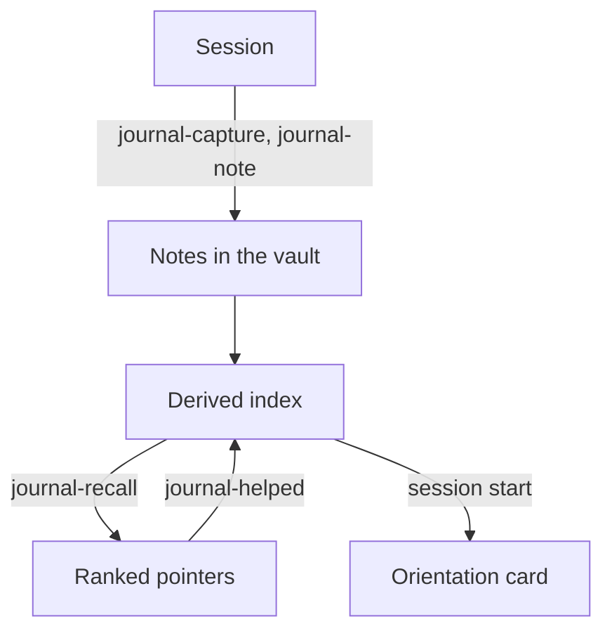

# claudestacks-journal

`claudestacks-journal` gives Claude a memory you can read. It keeps notes as plain Markdown files in
one vault on your machine. Claude writes the notes, you read and edit them, and Claude recalls them
later instead of working the same thing out again.

The notes use Zettelkasten mechanics: one idea each, named by a short kebab-case identifier and linked
to each other with `[[wikilinks]]`. Their lifecycle comes from Building a Second Brain: capture, organize,
distill, express. The vault is Obsidian-compatible, but nothing in it needs Obsidian. Recall uses a
rebuildable index with no embeddings, so the Markdown files stay the only source of truth.

## What it needs

Every hook and script in the plugin runs on `airsl`, so [install `airsl`
first](ch10-00-plugins-getting-started.md#install-airsl). The plugin also declares `claudestacks` as a
dependency, and the review command uses that plugin's `context-handoff` skill. Install `claudestacks`
before the journal.

```text
/plugin install claudestacks@claudestacks
/plugin install claudestacks-journal@claudestacks
```

These are commands for a Claude Code session, so there is no output to show.

## The vault

The vault is one store for all your projects, at `${AIRSSTACK_HOME:-~/.airsstack}/journal/`. It is not
split by project; each note records which project it belongs to.

```text
journal/
├── daily/        # one note per day, linking that day's sessions and notes
├── sessions/     # one story per session: session-<id8>.md
├── notes/        # atomic insight and decision notes: <kebab-stem>.md
├── mocs/         # maps of content, indexes of notes on one topic
├── .index/       # derived, rebuilt from the Markdown
└── .backups/     # archives taken before a review
```

`.index/` holds four files: `summaries.tsv`, `tags.json`, `graph.json` and `index.json`. Delete it at
any time and it is rebuilt from the notes. The project name on a note is the repository's folder
name, and every worktree of one repository shares it. Outside a repository it is the current folder's
name.



## Writing notes

Claude writes notes only when you ask. There is no automatic capture and no hook at session end.

| Skill | What it writes |
|---|---|
| `/claudestacks-journal:journal-capture` | The session story, `sessions/session-<id8>.md`, where `<id8>` is the first eight characters of the session id. Run it again at any time: each run rewrites the whole story from the transcript. |
| `/claudestacks-journal:journal-note <topic>` | One atomic note, `notes/<kebab-stem>.md`, of type `insight` or `decision`. Running it again for the same topic updates the note in place. The stem `_unresolved` is refused. |

Each skill gathers the session id, the transcript path and the project name on the main conversation,
and then starts a separate agent that reads the transcript and writes the file. The transcript never
enters your conversation, and only a one-line receipt comes back. The agents write only what the
transcript shows. Both also link the new note into the day's `daily/` note and refresh the index.

A session story has six sections: Intent, What happened, Decisions, Where it landed, Open threads and
Notes spun off. An atomic note has four: What it is, Why it exists, The reasoning and Implications.
A note written during a session carries that session's `<id8>`, which is how the story finds it to
list under Notes spun off.

### The note format

A note opens with a block of frontmatter. The plugin's
[`references/note-schema.md`](https://github.com/airsstack/claudestacks/tree/main/plugins/claudestacks-journal/references/note-schema.md) has the full format.

```text
---
title: Tokio cancellation safety
type: insight
project: airsclaude
domains: [async-rust, concurrency]
tags: [tokio, cancellation, shutdown]
created: 2026-06-23 14:42
updated: 2026-06-23 14:42
links: ["[[graceful-shutdown]]", "[[structured-concurrency]]"]
helped: 0
summary: await points are cancel points; drop guards still run on cancel
---
```

| Field | Meaning |
|---|---|
| `title` | The readable label. The file name is the identifier, not the title. |
| `type` | One of `insight`, `decision`, `session`, `daily` or `moc`. |
| `project` | The project name, or a list of them. |
| `domains`, `tags` | Broad subject areas and fine topic tags. |
| `created`, `updated` | Times in `YYYY-MM-DD HH:MM` form. |
| `links` | Outbound `[[wikilinks]]`. |
| `helped` | How often the note has aided a solution. It starts at `0`. |
| `summary` | A one-line summary, which recall returns beside the note's name. |
| `session` | The `<id8>` of the session that wrote the note. |
| `depends-on`, `supersedes` | Optional lists of `[[wikilinks]]` for notes this one builds on or replaces. |

A link matches a note by its stem, ignoring case. `[[Tokio-Cancellation-Safety]]` finds
`tokio-cancellation-safety.md`, and an alias such as `[[stem|alias]]` or a heading such as
`[[stem#heading]]` uses only the part before the `|` or `#`.

## Recalling notes

Recall returns short pointers, not note bodies, so it costs little to ask.

| Skill | What it does |
|---|---|
| `/claudestacks-journal:journal-recall <query>` | Starts an agent that reads only the index and returns up to eight pointers as `stem · summary · path · why`. It ranks by tag and domain match, summary and title text, the `helped` count and nearness in the link graph. Notes from your current project rank higher, and a strong match from another project still appears. |
| `/claudestacks-journal:journal-link <stem-or-topic>` | The same agent in link mode. Given a note, it suggests other notes that note could link to. It only suggests: if you ask for the links to be applied, Claude edits that one note itself. |
| `/claudestacks-journal:journal-helped <stem>` | Adds one to the note's `helped` count and refreshes the index. Use it after a recalled note helped. |

Claude reads at most the one note it picks from the pointers. If that note helped, confirm it, so the
note ranks higher next time:

```text
/claudestacks-journal:journal-recall tokio cancellation
/claudestacks-journal:journal-helped tokio-cancellation-safety
```

Claude can also run `journal-recall` on its own, before it works out something you may have noted
already. If the index does not exist yet, recall says so and returns nothing.

## What happens at session start

When a session starts, resumes or is cleared, a hook does three things without a model:

1. It creates the vault folders if they are missing.
2. It rebuilds the index if the index is absent or a note is newer than it.
3. It adds an orientation card to the session, for the project you are in.

The card is headed `Journal — recent activity` and lists up to three recent sessions and up to five
recently updated notes, each with its summary. When the vault has nothing for the project, the card is
left out. A malformed note is skipped and the rest are still indexed, so one bad file never blocks a
session.

## Reviewing the vault

`/claudestacks-journal:journal-review` tidies the vault in one command. It reviews the current
project. Pass `all` to review the whole vault.

```text
/claudestacks-journal:journal-review
/claudestacks-journal:journal-review all
```

The steps run in this order:

1. **Backup.** The command archives `daily/`, `sessions/`, `notes/` and `mocs/` to
   `.backups/<YYYY-MM-DD-HHMMSS>.tar.gz`. If that fails, the review stops before anything is written.
2. **Health report.** A script without a model finds three things. Orphans are notes with no links
   either way, and daily notes are exempt. Hubs are notes with 12 or more links in and out combined.
   Broken links are links whose target does not exist.
3. **Tidying.** The `journal-curator` agent applies changes that only add. It can create a map of
   content for a cluster of at least five notes, prepend a short `## TL;DR` to a long note, append a
   `## Narrative` to a daily note, add `depends-on` or `supersedes` links where the notes make a
   relationship plain, and add a link between notes that clearly share a topic. It leaves lower-confidence
   link suggestions for you to read.
4. **Index rebuild.** The index is rebuilt so the new links take effect.

The curator never deletes or rewrites existing text, never touches `sessions/` and never commits. The
command ends by telling you how to restore the backup:

```bash
tar xzf <archive> -C <vault>
```

That prints nothing. It puts back every file in the archive and leaves anything the curator created, such
as a new map of content in `mocs/`, so delete those by hand.

Typed `depends-on` and `supersedes` links show up as edge types in `index.json`. Where one pair of
notes is linked more than one way, the most specific type is kept, in the order `supersedes`,
`depends-on`, `contains`, `references`.

## Setting it up by hand

The vault is created on first use, so you rarely need this. `/claudestacks-journal:journal-setup`
creates the folders and forces a full rebuild of the index. It is idempotent, and you run it yourself.

## Settings

| Variable | Default | What it does |
|---|---|---|
| `AIRSSTACK_HOME` | `~/.airsstack` | The root that holds the `journal/` folder. |
| `AIRSSTACK_JOURNAL_BACKUP_KEEP` | `10` | How many review backups to keep. |
| `AIRSSTACK_JOURNAL_HUB_DEGREE` | `12` | The number of links at which the health report calls a note a hub. |
| `AIRSSTACK_JOURNAL_MOC_MIN` | `5` | The smallest cluster that gets a map of content. No script reads it. It is an instruction to the `journal-curator` agent, so treat it as a request. |

The `journal-curator` agent is the only one that runs on `opus`. The capture, note and recall agents run
on `sonnet`.
