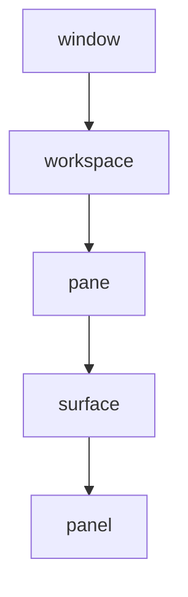

# claudestacks-cmux

`claudestacks-cmux` lets Claude Code drive the [cmux](https://cmux.com) terminal. It is four skills.
Each is a guide over the real `cmux` command line, with a small helper script for the jobs where a
script is safer than typing the commands by hand.

You need cmux on your machine. The skills run the `cmux` binary and do not include it. The helper
scripts run on `airsl`, so [install it first](ch10-00-plugins-getting-started.md#install-airsl). The
plugin has no hooks.

```text
/plugin install claudestacks-cmux@claudestacks
```

This is a command for a Claude Code session, so there is no output to show.

The skills are written against cmux 0.64.17. When your cmux differs, they tell Claude to run `cmux
--help` or `cmux capabilities` and trust that output over the skill's own list of commands.

## The four skills

| Skill | What it covers | Helper script |
|---|---|---|
| `cmux-control` | The hub. Windows, workspaces, panes and surfaces; sending input to a pane and reading its output; inspecting the layout; and cmux's signal commands. | `cmux-preflight.lua`, a health check to run before any automation |
| `cmux-workspace` | Creating and selecting workspaces, building multi-pane layouts, and grouping workspaces in the sidebar. | `cmux-layout.lua`, which builds a named workspace with splits |
| `cmux-browser` | Driving the browser surfaces inside cmux: open a page, wait, read it, click and type. | `cmux-snap.lua`, which reads the page, acts, and reads it again |
| `cmux-config` | Reading and editing `cmux.json`, custom commands and actions, shortcuts, and checking the config. | `cmux-settings.lua`, which backs up, edits and validates |

The other three skills build on `cmux-control`, which defines how to name and reach things.

## How cmux is laid out



A workspace is a sidebar tab, a pane is a split region inside it, and a surface is a tab inside a pane.
A surface can be a terminal, a browser or an agent session. A panel is an optional sub-split of a
surface.

You name a target with a UUID, a short ref such as `workspace:2` or `surface:4`, or an integer index.
Every terminal that cmux manages sets `CMUX_WORKSPACE_ID` and `CMUX_SURFACE_ID`, and most commands use
them as the default target. That default has a trap. A bare `cmux send "…"` goes to the caller's own
surface, which, from inside Claude Code, types into Claude's own prompt. When Claude works on another
workspace, it captures that workspace's refs and passes them on every call.

## Looking before acting

The skills start with commands that change nothing. Inspect the layout, then act:

```bash
cmux identify --json
cmux tree
```

These commands reach the cmux app on your machine, so this page shows no output for them.
`identify` reports the window, workspace, pane and surface of the caller, and `tree` shows the
workspaces in the caller's window.

The preflight script goes further. It checks that the `cmux` binary is on `PATH`, that its control
socket exists, and that the app answers a ping. It prints the version and the caller's workspace and
surface, or the same as JSON. It exits `0` when cmux is healthy and nonzero when it is not, and the
skill tells Claude never to carry on past a nonzero result.

## Panes and signals

`cmux-control` covers the commands that move text in and out of a pane: `send` and `send-key` to type,
`read-screen` and `capture-pane` to read, and `pipe-pane` to stream a pane into a command. It also
documents cmux's coordination commands: `events`, `wait-for`, `set-status`, `set-progress`, `notify`,
`set-buffer` and `set-hook`. The skill gives their syntax and sets no policy for using them together.

While scripting, Claude passes `--focus false` to commands that create things, so the view you are
working in does not jump.

## Workspaces and layouts

`cmux-workspace` acts on the caller's workspace unless a command names another. For a multi-pane
layout it uses `cmux-layout.lua`. You give it a name, any number of splits (`left`, `right`, `up` or
`down`) and an optional shell command for each pane. It creates the workspace without taking focus,
pins every split and command to a ref it captured when it made the piece, and prints the new
workspace ref. The layout therefore lands in the new workspace and never in the surface you are typing
in. It runs plain shell commands only. It does not start agent sessions, and it refuses the options
that would.

The same skill covers workspace groups, which are collapsible sidebar collections.

## The browser

`cmux-browser` follows one loop: navigate, wait, snapshot, act, then snapshot again. Claude never acts
on a stale snapshot, because a changed page makes old selectors wrong. After a `goto` it checks the
URL, because redirects and sign-in flows often change where the page ends up. It also avoids anything
that raises a blocking JavaScript dialog, since that freezes the surface. It reads the console and the
error list instead. `cmux-snap.lua` does the middle of the loop in one call: it takes an interactive
snapshot, performs the action, and takes another snapshot.

## Editing the config

`cmux-config` edits `cmux.json`. cmux looks for it in this order:

1. `./.cmux/cmux.json` in the project
2. `./cmux.json` in the project root
3. `~/.config/cmux/cmux.json` for your user, which is the normal file to edit

The file is JSONC, which allows comments, and the default file cmux writes is a commented template.
Claude therefore edits it in place as text. `jq` fails on the commented template and rewrites any file
it can read as plain JSON, so Claude uses it only after confirming the file has no comments and that you
accept losing any it missed.

Every edit follows the same steps. `cmux-settings.lua backup` copies the file to
`cmux.json.<timestamp>.bak`. Claude then edits the file, runs `cmux config validate`, and reloads with
`cmux reload-config`, which needs no restart. For a scripted edit, `cmux-settings.lua backup-then`
runs the edit command, validates the result and restores the backup if the config is invalid, so a
broken file is never left in place. `config validate`, `config check` and `config doctor` all print a full
report rather than a plain pass or fail, and all exit nonzero on an invalid config. The script
honours `CMUX_SETTINGS_FILE` when you keep the file elsewhere.

Terminal settings such as font, theme and background opacity belong in `~/.config/ghostty/config`, not
in `cmux.json`.

## What the plugin leaves out

The plugin documents the signal commands but includes no orchestration runtime. Starting Claude
sessions in other panes, with options such as `claude-teams`, is outside what these skills do.
