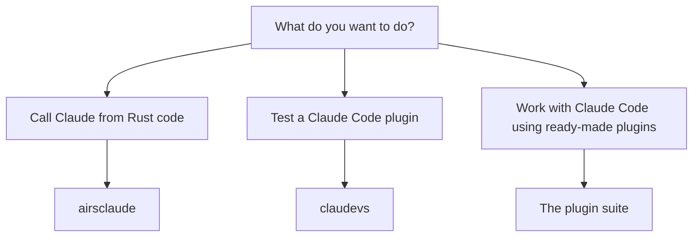

# Which product do you need?

This book covers three things that live in one repository. They work on their own, and you can read
the part you need without the others.

- **`airsclaude`** is a Rust library for talking to Claude. It holds two independent clients: one for
  Anthropic's Messages API, and one that drives the `claude` Code command line as a subprocess.
- **`claudevs`** tests Claude Code plugins. It runs a plugin's hooks and scripts the way Claude Code
  would, checks the plugin's wiring, and gives you one pass or fail answer you can run in CI.
- **The plugin suite** is a set of Claude Code plugins that carry a way of working: agents, skills and
  hooks for designing, reviewing and releasing changes.

## Pick a starting point

## airsclaude

`airsclaude` is an unofficial Rust SDK for Anthropic's Claude. It is not affiliated with
Anthropic. A Rust program gets what a Python or TypeScript program gets, written the way Rust code is
usually written.

The crate has two clients, and you will use one or the other:

- The **Messages API** client sends requests to Anthropic over HTTP. You hold the loop: you choose the
  model, you read each reply, and you decide whether to call a tool or ask again. It needs an API key.
- The **Agent SDK** starts the `claude` Code binary and talks to it. The agent reads files, runs
  commands and manages its own loop, and you watch and steer it. It needs no API key of its own,
  because it reuses whatever the `claude` binary is already signed in with.

Start with [Getting Started](ch01-00-airsclaude-getting-started.md), which helps you choose between the
two and installs the crate. Then make [your first call](ch02-01-first-call.md) with the Messages API,
or run [your first session](ch03-01-first-session.md) with the Agent SDK.

## claudevs

A Claude Code plugin is a folder of hooks, skills, agents and scripts. Most of it is code that runs
when Claude Code asks it to, and you rarely see it run until something goes wrong in a live session.

`claudevs` runs that code ahead of time, with no model in the loop, so the same input gives the same
answer every time. You describe a case in YAML or Lua, such as "this hook blocks this command", and
`claudevs test` checks it. `claudevs check` goes further and runs the whole gate: manifest validation,
wiring, the cases, and the cases again against the plugin as it looks once installed.

Start with [claudevs Getting Started](ch05-00-claudevs-getting-started.md).

## The plugin suite

The suite is built for Claude Code. It includes a plugin of agents and an orchestration skill that
take a task through coding and review, a workflow plugin that carries an idea through design to
finished work, guideline plugins for Rust and Python, a journal that keeps notes outside your
repository, and a plugin for driving the cmux terminal.

You install the plugins you want and leave the others.

Start with [Plugin Suite Getting Started](ch10-00-plugins-getting-started.md).

## How the book is laid out

Each part opens with a getting-started chapter, then works through the product one task at a time. The
chapters carry their own short examples, and the larger runnable programs sit beside the code in the
repository. The appendices hold the reference tables: the `claudevs` command line, how closely
`airsclaude` matches the official SDKs, and the places where it deliberately differs.
