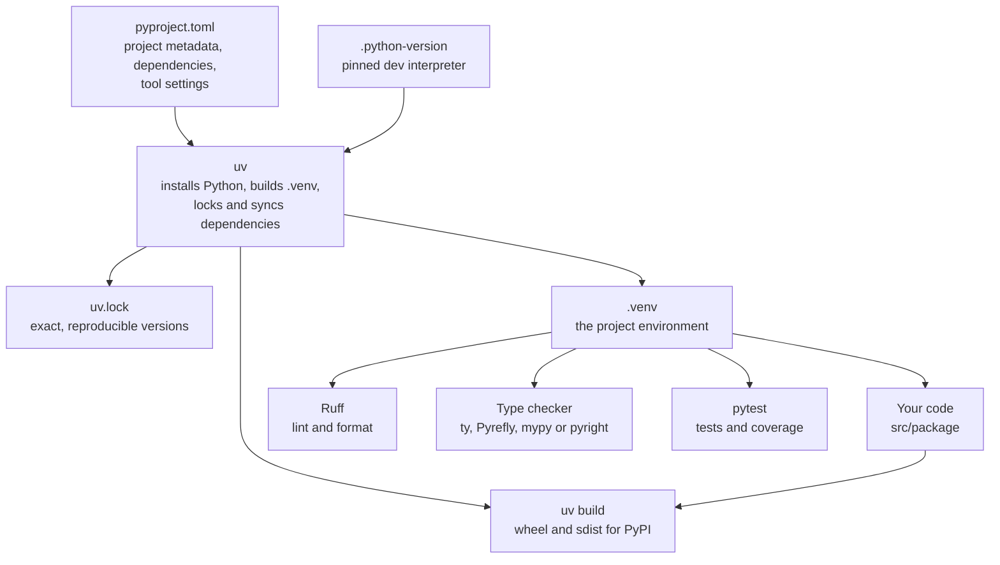
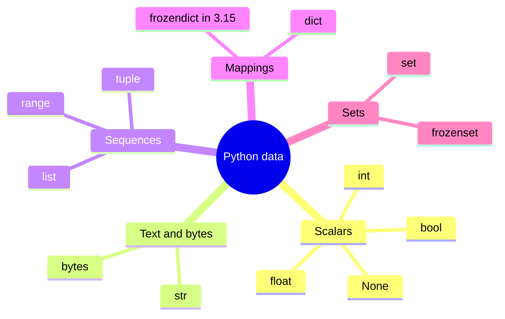
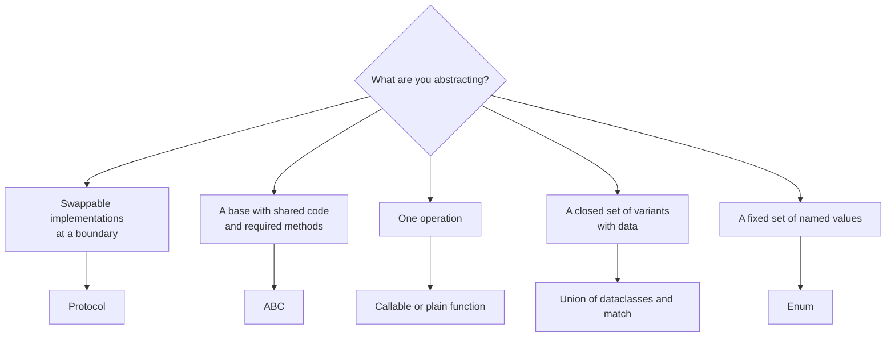
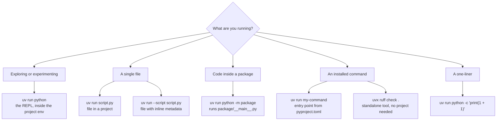
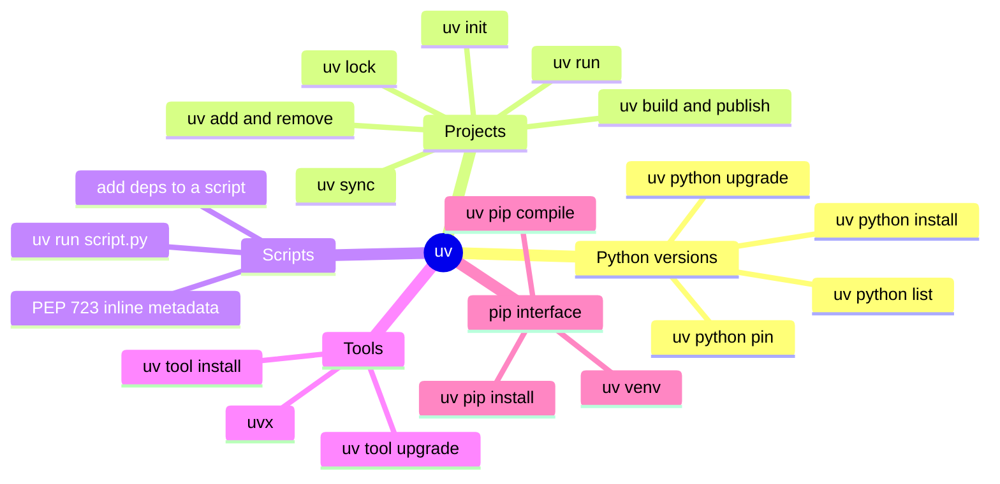
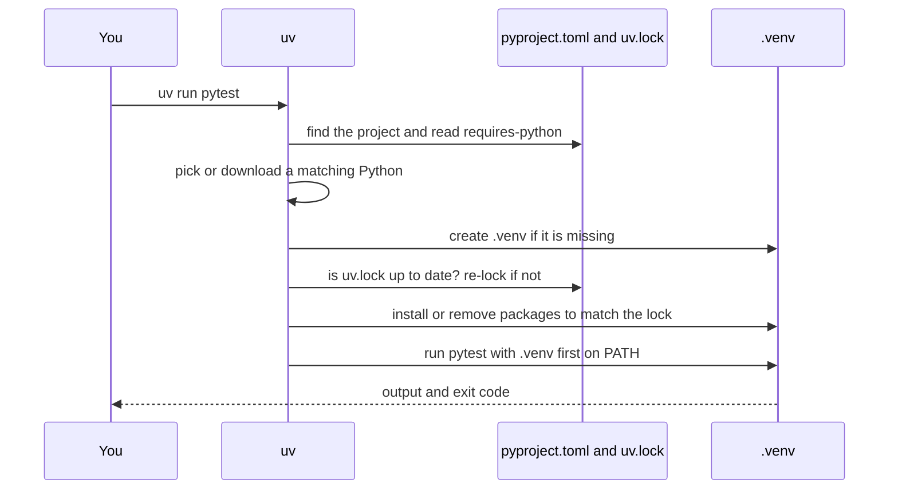
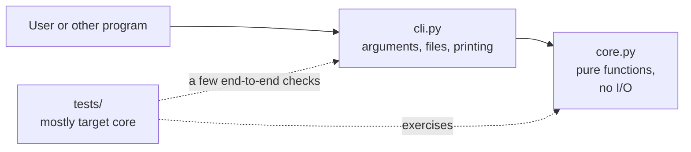
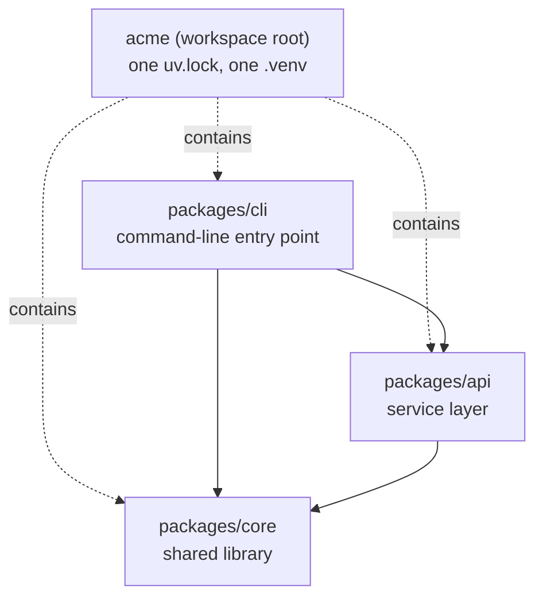
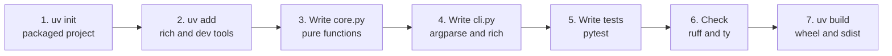

# Modern Python in 2026: A Refresher for Returning Developers

_Written on October 26, 2026. Current releases at the time of writing: Python 3.15, uv 0.13, Ruff 0.17, ty 0.0.x (beta). The code samples and commands in this guide were run before being written down: language samples on Python 3.14 and 3.15 (free-threaded 3.14t too), tooling samples with uv 0.13.5. Version numbers and release facts come from the sources in the References._

## How to use this guide

You used Python actively in the past, the fundamentals have gone fuzzy, and the ecosystem around the language has changed more in the last three years than in the ten before. This guide has two jobs: refresh the language itself (variables, loops, functions, classes, errors, files), and give you a working picture of how Python projects are built, run, and shipped today, with special attention to `uv`, which has become the center of that picture.

You do not have to read it in order. Sections 1 and 2 give you the new map. Section 3 and 4 are the language refresher and what changed in the language itself. Sections 5 to 7 cover running code, pip, and uv in depth. Sections 8 to 10 cover project structure and the quality toolchain, and Section 8.4 covers monorepos with uv workspaces, Section 11 builds a small real project end to end so everything clicks together. Section 12 is a four-week relearning plan.

---

## 1. The 2026 mental model

The biggest shift is not any single language feature. It is that **the project is now described by one standard file, `pyproject.toml`, and one tool, `uv`, drives almost everything around it**: installing Python itself, creating the virtual environment, resolving and locking dependencies, running your code, and building the package [8]. `uv` is a single Rust program that can stand in for pip, pip-tools, pipx, Poetry, pyenv, twine, and virtualenv [8], and it ships both a pip-compatible interface (`uv pip install ...`) and a first-class project interface (`uv add ...`) with lockfiles and workspaces [8].

The table below translates the habits you probably remember into what most teams do now.

|What you probably remember|What most people do in 2026|
|---|---|
|`python -m venv .venv`, `source .venv/bin/activate`, `pip install -r requirements.txt`|`uv sync`, then `uv run ...` (no activation step needed) [13]|
|`requirements.txt` (plus `pip-tools`)|`pyproject.toml` for intent, `uv.lock` for exact versions [11][21]|
|`setup.py` / `setup.cfg`|`pyproject.toml` with `[project]` and `[build-system]` [10]|
|`pyenv` or whatever Python the OS has|`uv python install 3.14` and a `.python-version` file [6][13]|
|`pipx install` / `pipx run`|`uv tool install` / `uvx` [13]|
|`dev-requirements.txt`, ad-hoc extras|`[dependency-groups]` (PEP 735) via `uv add --dev` [15][16]|
|`black` + `isort` + `flake8` + `pyupgrade`|One tool: Ruff (`ruff check`, `ruff format`) [23]|
|`mypy` only|`mypy` or `pyright`, plus new Rust checkers: ty (Astral, beta) and Pyrefly (Meta) [21][27]|
|`typing.List[int]`, `Optional[int]`, `TypeVar("T")`|`list[int]`, `int|
|A script with a `requirements.txt` next to it|A single file with inline metadata (PEP 723), run by `uv run script.py` [24]|
|`if x is None: ... elif ...` ladders for shapes of data|`match` / `case` structural pattern matching [4]|

If you only keep ten rules from this guide, keep these:

1. Declare your project in `pyproject.toml`; never hand-maintain a `requirements.txt` for a project you own.
2. Let `uv` create and manage the virtual environment. Do not activate it by hand; use `uv run`.
3. Commit `uv.lock`. It is what makes your environment reproducible [21].
4. Put development tools (pytest, ruff, a type checker) in a dependency group, not in your runtime dependencies [15].
5. Use the `src/` layout for anything you might package, test seriously, or share [19][20].
6. Pin your development Python in `.python-version`; declare the supported range in `requires-python`. They are different things [18].
7. Run everything through `uv run` (project code) or `uvx` (standalone tools) rather than global installs [21].
8. Use Ruff for formatting and linting, and add a type checker early; modern type hints cost almost nothing [23][5].
9. Write small scripts as single files with PEP 723 inline dependencies instead of inventing a project for them [24].
10. Treat new dependencies as a security decision: lock them, and consider a dependency cooldown (Section 7.11) [17].

---

## 2. The landscape in October 2026

### 2.1 Which Python?

Python ships a new feature release every October, and each release gets five years of support [30]. Python 3.15 was released on October 9, 2026 [1], so the current picture looks like this (end-of-life years are derived from the five-year policy):

|Version|Released|End of life|Notes|
|---|---|---|---|
|3.10|Oct 2021|Oct 2026|Reaching end of life now; Ruff 0.17 raised its default target from 3.10 to 3.11 for this reason [23]|
|3.11|Oct 2022|2027|Still supported|
|3.12|Oct 2023|2028|Introduced the `def f[T]()` / `type X = ...` syntax [5]|
|3.13|Oct 2024|2029|Free-threaded build and JIT introduced as experiments|
|3.14|Oct 2025|2030|Free-threaded Python officially supported, t-strings [3]|
|**3.15**|**Oct 9, 2026**|2031|Lazy imports, `frozendict`, `sentinel`, UTF-8 by default [1]|

A sensible default today: **develop on 3.14 or 3.15**, and set `requires-python` to the oldest version you actually test against. Brand-new releases occasionally lag at the library level (some packages ship wheels a few weeks after October), so if a dependency refuses to install on 3.15, fall back to 3.14 for that project and move on. With `uv` this costs one command (`uv python pin 3.14`).

### 2.2 The toolchain at a glance

Most modern Python projects are assembled from the same handful of parts. The diagram shows how they relate: `pyproject.toml` is the single source of truth, and `uv` reads it to manage the interpreter, the environment, and the lockfile, while Ruff, a type checker, and pytest run inside that environment.



### 2.3 A note on who owns the tools

`uv`, Ruff, and ty are made by Astral. In March 2026 OpenAI announced it would acquire Astral, with the team joining its Codex group after the deal closes; both companies said the open-source tools would continue to be supported [25][26]. The tools are MIT and Apache licensed, so forking remains possible if priorities ever change [26]. For you as a learner, the practical conclusion is simple: nothing about your day-to-day usage changes, the standards these tools implement (pyproject.toml, PEP 723, PEP 735) are tool-neutral, and if you ever want to step back to plain pip, pip 26.0 (January 2026) now supports PEP 723 inline scripts via `--requirements-from-script`, a datetime filter equivalent to uv's `--exclude-newer` (`--uploaded-prior-to`), and an experimental `pip lock` [14]. What pip still does not do is manage Python interpreters, run tools in throwaway environments, or produce a universal cross-platform lockfile, which is why `uv` remains the recommended default for new projects [14].

---

## 3. The language, refreshed

This section is a fast, runnable refresher. Every snippet below was executed on Python 3.14. Type them into a REPL (`uv run python`) rather than just reading them; the fastest way to remember Python is to type it.

### 3.1 Variables and basic types

A variable is just a name bound to an object. There are no declarations, and the same name can be rebound to a different type later. Type annotations are optional documentation that tools can check; Python itself ignores them at runtime.

```python
name = "Ada"            # str
age = 36                # int
height = 1.68           # float
is_admin = False        # bool
nothing = None          # NoneType: "no value"
count: int = 0          # an annotation; optional, but type checkers read it

print(type(name).__name__, type(age).__name__, type(nothing).__name__)
# str int NoneType
```

Two ideas to keep in your head. First, **everything is an object**, and assignment never copies: `b = a` makes two names for one object, which matters the moment the object is mutable (lists, dicts, sets). Second, names are lowercase with underscores (`user_name`), classes are `CapitalizedWords`, and constants are `UPPER_CASE`; Ruff and the community's PEP 8 style expect it.

### 3.2 Strings

Use f-strings for formatting. They evaluate expressions inside braces and accept a format spec after a colon; `!r` shows the `repr`, and `=` prints the expression and its value, which is handy for debugging.

```python
price = 1234.5
print(f"{name!r} pays {price:,.2f}")   # 'Ada' pays 1,234.50
print(f"{age=}")                       # age=36

print(" a,b ,c ".strip().split(","))   # ['a', 'b ', 'c']
print("-".join(["x", "y", "z"]))       # x-y-z
print("python"[1:4], "python"[::-1])   # yth nohtyp   (slicing: start:stop:step)
```

Strings are immutable: methods like `strip()` and `upper()` return new strings. For text that will be rendered into HTML, SQL, or shell commands, Python 3.14 added a safer cousin of the f-string, covered in Section 4.

### 3.3 Collections

Python's four workhorse containers are lists, tuples, dictionaries, and sets. Choose by behavior: ordered and changeable (`list`), ordered and fixed (`tuple`), key to value (`dict`), unique members (`set`).

```python
nums = [3, 1, 2]
nums.append(5)
nums.sort()                      # in place: [1, 2, 3, 5]

point = (3, 4)
x, y = point                     # unpacking

user = {"name": "Ada", "langs": ["py"]}
user["age"] = 36
merged = user | {"city": "London"}        # dict merge with |
print(user.get("email", "n/a"))           # n/a  (no KeyError)

tags = {"a", "b"} | {"b", "c"}            # set union
print(sorted(tags))                       # ['a', 'b', 'c']

first, *rest = [1, 2, 3, 4]               # star-unpacking
print(first, rest)                        # 1 [2, 3, 4]
```

The mind map below groups the built-in types. Python 3.15 adds an immutable `frozendict` next to `frozenset` [1].



### 3.4 Conditions and pattern matching

`if`, `elif`, and `else` work as you remember, and indentation is the syntax. Empty containers, `0`, `""`, and `None` are falsy. Since Python 3.10 there is also `match`, which compares a value against successive patterns and can take structures apart as it goes; the official tutorial describes it as similar to a `switch` statement but able to bind variables from the pattern [4].

```python
def classify(n: int) -> str:
    if n < 0:
        return "negative"
    elif n == 0:
        return "zero"
    return "positive"

def handle(command: list[str]) -> str:
    match command:
        case ["go", direction]:
            return f"going {direction}"
        case ["pick", "up", item]:
            return f"picked {item}"
        case ["quit" | "exit"]:
            return "bye"
        case _:                       # wildcard: never fails to match
            return "unknown"

print(handle(["go", "north"]))        # going north
label = "adult" if age >= 18 else "minor"    # conditional expression
```

### 3.5 Loops and comprehensions

`for` iterates over anything iterable. Reach for `enumerate` when you need the index and `zip` to walk sequences in parallel (`strict=True` raises an error if the lengths differ, which catches real bugs). A loop can carry an `else` clause that runs only if the loop finished without `break`.

```python
for i, ch in enumerate("abc", start=1):
    print(i, ch)                              # 1 a / 2 b / 3 c

print(list(zip([1, 2], ["a", "b"], strict=True)))   # [(1, 'a'), (2, 'b')]

for n in range(2, 10):
    if n % 7 == 0:
        print("found", n)
        break
else:                                          # runs only if no break happened
    print("no multiple of 7")

i = 0
while i < 3:
    i += 1
```

Comprehensions are the idiomatic way to build a collection from another; a generator expression (parentheses, no brackets) produces values lazily and is ideal inside `sum`, `any`, and `max`.

```python
squares = [n * n for n in range(5) if n % 2 == 0]       # [0, 4, 16]
lookup = {w: len(w) for w in ["apple", "fig"]}          # {'apple': 5, 'fig': 3}
unique_lengths = {len(w) for w in ["apple", "fig"]}     # a set
total = sum(n * n for n in range(1000))                 # generator, no list built
```

### 3.6 Functions

Functions are objects; define them with `def`. You can mix positional parameters, defaults, keyword-only parameters (after `*`), positional-only parameters (before `/`), and variadics (`*args`, `**kwargs`). Document with a docstring and annotate with types.

```python
def greet(name: str, /, greeting: str = "Hello", *, shout: bool = False) -> str:
    msg = f"{greeting}, {name}"
    return msg.upper() if shout else msg

print(greet("Ada"))                           # Hello, Ada
print(greet("Ada", "Hi", shout=True))         # HI, ADA

def stats(*values: float, **options: str) -> tuple[float, float]:
    return min(values), max(values)           # returning a tuple = "multiple values"
```

The one trap every returning Pythonista should re-learn: **default values are evaluated once, when the function is defined**, so a mutable default is shared across calls. Ruff's bugbear rules (`B006`) flag this, and the 0.16 default ruleset now includes them [23].

```python
def bad_append(item, bucket=[]):        # the classic bug
    bucket.append(item)
    return bucket

def good_append(item, bucket=None):     # the fix: None as a sentinel
    bucket = [] if bucket is None else bucket
    bucket.append(item)
    return bucket

bad_append(1)
print(bad_append(2))                    # [1, 2]  <- surprise: shared list
print(good_append(1), good_append(2))   # [1] [1]
```

Closures and decorators follow naturally: a decorator is a function that takes a function and returns a function. The standard library already ships useful ones, such as `functools.cache` for memoization.

```python
from functools import cache

@cache
def fib(n: int) -> int:
    return n if n < 2 else fib(n - 1) + fib(n - 2)

print(fib(80))     # 23416728348467685, instant thanks to the cache
```

### 3.7 Type hints, the modern way

Type hints are optional, but they make editors smarter and let a checker find bugs before tests do. The syntax has been simplified a lot since you last wrote it: built-in generics (`list[int]`, `dict[str, int]`), `X | None` instead of `Optional[X]`, abstract types from `collections.abc`, and, since Python 3.12, type parameters declared inline with PEP 695 syntax rather than `TypeVar` boilerplate [5][29].

```python
from collections.abc import Callable

def lookup_user(uid: int) -> str | None:             # replaces Optional[str]
    return {1: "Ada"}.get(uid)

def first_item[T](items: list[T]) -> T:              # generic function (3.12+)
    return items[0]

type Pair[T] = tuple[T, T]                           # type alias statement (3.12+)

def swap[T](p: Pair[T]) -> Pair[T]:
    return p[1], p[0]

def apply(f: Callable[[int], int], v: int) -> int:
    return f(v)
```

PEP 695's scoping also means a type parameter belongs to the function or class that declares it, instead of being a loose module-level `T = TypeVar("T")` shared by everything [29].

### 3.8 Classes, dataclasses, and enums

You will write far fewer hand-rolled `__init__` methods than you remember. For plain data holders, use `@dataclass`: it generates `__init__`, `__repr__`, and equality for you. `frozen=True` makes instances immutable and `slots=True` makes them lighter. Use `Enum` for fixed sets of choices and `@property` for computed attributes.

```python
from dataclasses import dataclass, field
from enum import Enum, auto

class Role(Enum):
    ADMIN = auto()
    USER = auto()

@dataclass(slots=True, frozen=True)
class User:
    name: str
    role: Role = Role.USER
    tags: tuple[str, ...] = ()

    @property
    def is_admin(self) -> bool:
        return self.role is Role.ADMIN

@dataclass
class Team:
    members: list[User] = field(default_factory=list)   # never `= []` here

team = Team([User("Ada", Role.ADMIN), User("Linus")])
print(team.members[0])
# User(name='Ada', role=<Role.ADMIN: 1>, tags=())
print(team.members[0].is_admin)    # True
```

### 3.9 Errors and context managers

Handle expected failures with `try` / `except`, use `else` for the success path, and `finally` for cleanup that must always run. Raise your own exception types for domain errors and chain the original with `raise ... from`, so the traceback keeps the root cause. A `with` block guarantees cleanup (closing files, releasing locks), and `contextlib.contextmanager` lets you write one as a generator.

```python
from collections.abc import Iterator
from contextlib import contextmanager

class ConfigError(Exception):
    """Raised when configuration is invalid."""

def load_port(raw: str) -> int:
    try:
        port = int(raw)
    except ValueError as exc:
        raise ConfigError(f"bad port: {raw!r}") from exc
    else:
        return port

try:
    load_port("abc")
except ConfigError as err:
    print("caught:", err, "| cause:", type(err.__cause__).__name__)
# caught: bad port: 'abc' | cause: ValueError

@contextmanager
def announce(label: str) -> Iterator[None]:
    print(f"start {label}")
    try:
        yield
    finally:
        print(f"end {label}")

with announce("work"):
    pass                                   # start work / end work
```

### 3.10 Files, paths, and JSON

Use `pathlib.Path` instead of string paths and `os.path`. It handles separators across operating systems and has `read_text`, `write_text`, `glob`, and friends built in. Always pass `encoding="utf-8"` explicitly when you read or write text. Python 3.15 makes UTF-8 the default encoding everywhere [1], but explicit encoding keeps your code correct on older interpreters too.

```python
import json
import tempfile
from pathlib import Path

with tempfile.TemporaryDirectory() as d:
    p = Path(d) / "config.json"
    p.write_text(json.dumps({"debug": True}, indent=2), encoding="utf-8")
    print(json.loads(p.read_text(encoding="utf-8")))     # {'debug': True}
    print(p.suffix, p.stem, p.parent == Path(d))         # .json config True
    for f in Path(d).glob("*.json"):
        print("found", f.name)                           # found config.json
```

### 3.11 Modules, imports, and the `__main__` guard

A module is a `.py` file; a package is a directory of modules (normally with an `__init__.py`). Imports go at the top of the file in three groups (standard library, third party, your own), which Ruff will sort for you. The `if __name__ == "__main__":` guard makes a file both importable and runnable: the block only executes when the file is run directly, not when another module imports it.

```python
import json                       # standard library
from pathlib import Path

import httpx                      # third party

from myapp.core import top_words  # your own package (absolute import)


def main() -> None:
    print("running")


if __name__ == "__main__":
    main()
```

### 3.12 Async in one screen

`async def` defines a coroutine, `await` waits for one, and `asyncio.run` starts the event loop. Since Python 3.11, `asyncio.TaskGroup` is the structured way to run tasks concurrently: when the `async with` block exits, every task has finished, and if one fails the rest are cancelled.

```python
import asyncio

async def fetch(n: int) -> int:
    await asyncio.sleep(0.01)         # stand-in for network I/O
    return n * 2

async def main() -> list[int]:
    async with asyncio.TaskGroup() as tg:
        tasks = [tg.create_task(fetch(i)) for i in range(3)]
    return [t.result() for t in tasks]

print(asyncio.run(main()))            # [0, 2, 4]
```

Async is for I/O-bound concurrency (many network calls). For CPU-bound parallelism, see free-threaded Python in the next section.

### 3.13 Abstractions: interfaces, base classes, and variants

Python has no single `trait` or `interface` keyword. It gives you several tools instead, and the right one depends on what you are abstracting. If you know Rust traits, the closest match is `Protocol`. The examples in this section were run on Python 3.14 and type-checked with `ty`.



**`Protocol`: structural typing.** A `Protocol` lists the methods a type must have. Any class with those methods satisfies it, with no `impl Trait for Type` and no inheritance. The type checker enforces it [32].

```python
from typing import Protocol

class Storage(Protocol):
    def save(self, key: str, value: bytes) -> None: ...
    def load(self, key: str) -> bytes: ...

class MemoryStorage:                      # never mentions Storage
    def __init__(self) -> None:
        self._data: dict[str, bytes] = {}

    def save(self, key: str, value: bytes) -> None:
        self._data[key] = value

    def load(self, key: str) -> bytes:
        return self._data[key]

def archive(store: Storage, key: str, text: str) -> bytes:
    store.save(key, text.encode())        # accepts anything shaped like Storage
    return store.load(key)

print(archive(MemoryStorage(), "a", "hi"))    # b'hi'
```

Use it for dependency inversion (storage backends, HTTP clients, clocks) and for writing fakes in tests. Protocols can be generic with the 3.12 syntax: `class Repository[T](Protocol): def get(self, id: int) -> T | None: ...`.

**`ABC`: nominal typing with shared code.** An abstract base class is inheritance-based. It cannot be instantiated, subclasses must implement every `@abstractmethod`, and it can carry concrete methods. The `@override` decorator (3.12+) makes the checker complain if the parent has no such method.

```python
from abc import ABC, abstractmethod
from dataclasses import dataclass
from typing import override

class Shape(ABC):
    @abstractmethod
    def area(self) -> float: ...

    def describe(self) -> str:            # shared behavior
        return f"{type(self).__name__} with area {self.area():.2f}"

@dataclass(frozen=True)
class Square(Shape):
    side: float

    @override
    def area(self) -> float:
        return self.side**2

print(Square(2).describe())               # Square with area 4.00
Shape()                                   # TypeError: Can't instantiate abstract class Shape ...
```

Prefer `ABC` when you control the whole hierarchy and want to share implementation. Prefer `Protocol` at the boundaries between modules.

**Functions as abstractions.** When the abstraction is one operation, pass a function instead of writing a one-method class.

```python
from collections.abc import Callable

type Handler = Callable[[str], str]

def make_logger(prefix: str) -> Handler:
    return lambda msg: f"[{prefix}] {msg}"

print(make_logger("app")("started"))      # [app] started
```

**Variants with data.** Python has no enum that carries data like a Rust `enum`. The usual substitute is a union of small frozen dataclasses plus `match`, and a type checker can warn about unhandled cases.

```python
@dataclass(frozen=True)
class Circle:
    r: float

@dataclass(frozen=True)
class Rect:
    w: float
    h: float

type Figure = Circle | Rect

def area(f: Figure) -> float:
    match f:
        case Circle(r):
            return 3.14159 * r * r
        case Rect(w, h):
            return w * h

print(area(Rect(2, 3)))                   # 6
```

Use a plain `Enum` for fixed choices with no data attached.

**Where Python differs from Rust:**

- **Enforcement is a tool, not the compiler.** Protocols and type hints are checked by `ty`, `mypy`, or `pyright`, not by Python at runtime. Without a checker in CI you get no guarantee.
- **`@runtime_checkable` is shallow.** It lets `isinstance` work against a Protocol, but it only checks that the method names exist, not their signatures.
- **No coherence rules.** Anything can satisfy a Protocol, and you cannot implement a trait for a foreign type. Adapt it with a wrapper class or a plain function instead.
- **No real privacy.** `_name` is only a convention, so abstractions are held up by discipline and tests.
- **Duck typing is still the default.** An object works if it has the right methods. Protocols and type hints write down and check what duck typing already did.
- **Prefer composition.** As in Rust, hold a collaborator as a field and delegate to it instead of building deep class hierarchies.

---

## 4. What changed in the language (3.12 to 3.15)

If you left Python around 3.9 or 3.10, these are the changes worth knowing. They are listed from "use this every day" to "good to know exists".

|Feature|Since|What it gives you|
|---|---|---|
|`match` / `case`|3.10|Structural pattern matching [4]|
|`def f[T]()`, `class C[T]`, `type X = ...`|3.12|Generics and aliases without `TypeVar` boilerplate [5]|
|Deferred annotation evaluation|3.14|Annotations are no longer evaluated eagerly, so forward references mostly just work [1]|
|Template strings (t-strings)|3.14|`t"..."` builds a `Template` object for safe HTML, SQL, and similar processing [3]|
|Free-threaded build officially supported|3.14|A CPython build without the GIL, for true multi-core threads [3]|
|Lazy imports (`lazy import x`)|3.15|Defer importing a module until first use, cutting start-up time [1]|
|`frozendict` and `sentinel` built-ins|3.15|An immutable dict, and a proper "no value given" marker [1]|
|Unpacking in comprehensions|3.15|`[*row for row in rows]` flattens without `itertools.chain` [1]|
|UTF-8 as the default encoding|3.15|Text files default to UTF-8 on every platform [1]|
|`profiling` package with a sampling profiler (Tachyon)|3.15|A low-overhead profiler that can attach to a running process [1]|
|Faster experimental JIT|3.15|Larger speedups on a wider range of code, still experimental [1]|

Python 3.14 also added a safe external debugger interface and made `pdb` able to attach to a running process by PID, plus a command-line tool to inspect running asyncio tasks [3].

### 4.1 Template strings (3.14)

An f-string immediately becomes a plain `str`, so by the time you hold the result you cannot tell which parts were literal and which were user input. A t-string keeps them separate, so a library can escape or parameterize the interpolated values safely. The following example escapes HTML; it ran on Python 3.14.

```python
import html
from string.templatelib import Interpolation, Template

def render_html(template: Template) -> str:
    """Escape every interpolated value; leave the literal parts alone."""
    parts: list[str] = []
    for part in template:
        if isinstance(part, Interpolation):
            parts.append(html.escape(str(part.value)))
        else:
            parts.append(part)
    return "".join(parts)

user_input = "<script>alert(1)</script>"
page = t"<p>Hello {user_input}</p>"
print(render_html(page))
# <p>Hello &lt;script&gt;alert(1)&lt;/script&gt;</p>
```

Libraries are starting to accept templates directly for query building, for example database drivers documenting template-string queries [3]; expect this to become the standard answer to string-built SQL and HTML injection.

### 4.2 The 3.15 additions

These need Python 3.15; on older interpreters they are syntax errors, so only use them once your `requires-python` allows it. The sample ran on 3.15.1.

```python
lazy import json                      # not loaded until first real use
import sys

print("json" in sys.modules, "json" in sys.lazy_modules)   # False True
print(json.dumps({"ok": True}))                            # first use loads it
print("json" in sys.modules)                               # True

config = frozendict(host="localhost", port=8080)           # immutable mapping
try:
    config["port"] = 1
except TypeError:
    print("immutable")

MISSING = sentinel("MISSING")          # replaces the old `object()` idiom
def patch(value=MISSING):
    return "no value given" if value is MISSING else f"got {value!r}"
print(patch(), patch(None))            # no value given  got None

rows = [[1, 2], [3], [4, 5]]
print([*row for row in rows])          # [1, 2, 3, 4, 5]
```

Lazy imports are opt-in per import statement; for code that must still run on older Pythons, PEP 810 also defines a `__lazy_modules__` list that has the same effect without new syntax [1]. The new `sentinel` prints readably in `help()` output and, unlike a bare `object()`, behaves correctly under copy and pickle [1].

### 4.3 Free-threaded Python

The Global Interpreter Lock (GIL) has historically prevented two Python threads from running bytecode at the same time. Python 3.13 introduced an optional free-threaded build, and 3.14 made it officially supported [3]. It is a separate interpreter build, not a switch, and many compiled libraries must ship free-threaded wheels before you can rely on it for real workloads. `uv` can install it, and you can confirm the GIL is off from inside Python:

```console
$ uv python install 3.14t
$ uv run --python 3.14t python -c "import sys; print(sys._is_gil_enabled())"
False
```

`uv` supports discovering and installing free-threaded variants for CPython 3.13 and newer [6][7]. For now, treat it as something to experiment with on CPU-bound threaded code, not as a default.

---

## 5. Running Python code

There are several ways to run Python, and the choice depends on whether you are exploring, running a one-off file, running part of a package, or running something you installed. The flowchart gives the decision path; the sections after it explain each branch.



### 5.1 The REPL

Run `python` (or `uv run python` to get the project's interpreter and dependencies) with no arguments to start the interactive prompt. Since Python 3.13 the REPL supports multi-line editing, history across blocks, and colored output; inside it, `help(obj)`, `dir(obj)`, and `_` (the last result) are the tools you will use most. `python -i script.py` runs a file and then drops you into the REPL with all its names defined, which is a quick way to poke at the result of a script.

### 5.2 Scripts and modules

```console
python hello.py                 # run a file
python -c "print(2 ** 10)"      # run a string
python -m http.server 8000      # run a module by import name
python -m pytest -q             # many tools are modules too
python -m pip --version         # prefer this over bare `pip`
```

`python file.py` and `python -m package.module` look similar but differ in an important way. With `python file.py`, Python puts the file's **directory** at the front of the import path. With `python -m name`, Python puts the **current directory** there and imports `name` as a module. The practical rule is: if the code is part of a package that you import elsewhere, run it with `-m` (or, better, through an entry point), because running a package file as a loose script breaks its relative imports. The usual way to make a package runnable is a `__main__.py` file, which `python -m package` executes.

Why prefer `python -m pip` over `pip`? It guarantees that the `pip` you run belongs to the same interpreter as `python`. On a machine with several Pythons, the bare `pip` command on your `PATH` may belong to a different one, which is the origin of many "I installed it but I can't import it" mysteries.

### 5.3 Entry points: turning a function into a command

When your project is meant to be run as a command, declare an entry point in `pyproject.toml`. The installer then generates an executable with that name in the environment:

```toml
[project.scripts]
wordstat = "wordstat:main"        # command = "package:function"
```

After `uv sync`, `uv run wordstat sample.txt` calls `wordstat.main()`. The same entry point is what users get when they run `uv tool install` or `pip install` on your published package [10].

### 5.4 With uv: you rarely activate anything

The classic workflow was to create a virtual environment, activate it, and then run `python`. `uv run` replaces all of that. Before executing your command, it makes sure the project's environment exists and matches the lockfile, so you can run anything inside the project without activating or thinking about the venv [9][13].

```console
uv run python script.py
uv run pytest
uv run python -m wordstat sample.txt
uv run --with httpx python -c "import httpx; print(httpx.__version__)"   # one-off extra package
uv run --no-project script.py                  # ignore the project in this directory
```

Activating the environment is still available (`source .venv/bin/activate`, or `.venv\Scripts\activate` on Windows) and is sometimes convenient for interactive shell work or for tools that insist on a bare `python` on `PATH`, but the day-to-day habit is `uv run`.

### 5.5 Single-file scripts with inline dependencies (PEP 723)

For a script that does not deserve a project, PEP 723 lets the file carry its own requirements in a specially formatted comment block. `uv` reads the block, builds a cached throwaway environment, and runs the script [24]. This is the modern answer to "my script needs `requests` and I don't want to make a venv".

```python
#!/usr/bin/env -S uv run --script
# /// script
# requires-python = ">=3.13"
# dependencies = [
#     "httpx>=0.28",
#     "rich>=14",
# ]
# ///
"""Fetch a URL and report its status."""

import sys

import httpx
from rich import print


def main() -> None:
    url = sys.argv[1] if len(sys.argv) > 1 else "https://example.com"
    response = httpx.get(url, follow_redirects=True)
    print(f"[bold]{url}[/bold] -> {response.status_code} {response.reason_phrase}")


if __name__ == "__main__":
    main()
```

You can create and edit these blocks with commands instead of by hand:

```console
uv init --script fetch.py --python 3.13      # create a script with a metadata block
uv add --script fetch.py httpx rich          # add dependencies into the block
uv run fetch.py https://example.com          # run it
uv lock --script fetch.py                    # optional: write fetch.py.lock for reproducibility
chmod +x fetch.py && ./fetch.py              # works because of the shebang (Linux and macOS)
```

The shebang `#!/usr/bin/env -S uv run --script` only helps on Unix-like systems; on Windows, run `uv run fetch.py`. Because PEP 723 is a standard rather than a `uv` feature, other tools read the same block, and pip 26.0 can install a script's dependencies with `--requirements-from-script` [14].

---

## 6. pip and virtual environments (the classic flow)

You should still know the classic tools, for three reasons: you will meet them in older projects and in documentation, `uv` deliberately mirrors their commands, and the concepts (environment, install, freeze) are the same underneath.

### 6.1 What a virtual environment is

A virtual environment is a directory (conventionally `.venv`) that holds a copy of, or link to, a Python interpreter plus its own `site-packages` folder. Packages you install go there instead of into the system Python, so two projects can use different versions of the same library without interfering [13]. Modern Linux distributions and Homebrew also mark the system Python as "externally managed" (PEP 668), so `pip install` outside a virtual environment is refused with an `externally-managed-environment` error; this is intended, and the answer is always "use an environment" rather than `--break-system-packages`.

### 6.2 The classic workflow

```console
$ python3 -m venv .venv                 # create the environment
$ source .venv/bin/activate             # activate it (Windows: .venv\Scripts\activate)
(.venv) $ python -m pip install requests
(.venv) $ python -m pip list
(.venv) $ python -m pip freeze > requirements.txt     # record exact versions
(.venv) $ python -m pip install -r requirements.txt   # recreate elsewhere
(.venv) $ python -m pip install -e .                  # editable install of your own project
(.venv) $ python -m pip check                         # report broken dependency pairs
(.venv) $ deactivate
```

This flow works, and it is fine for a throwaway experiment. Its weaknesses are the reason newer tooling exists: `pip freeze` captures transitive dependencies without recording which ones you chose on purpose, there is no real lockfile, and nothing manages the Python version. `pip` itself is catching up slowly; version 26.0 added `--requirements-from-script`, the `--uploaded-prior-to` date filter, and an experimental `pip lock` command [14].

### 6.3 Translating pip commands to uv

`uv` provides a drop-in interface under `uv pip`, plus its own higher-level commands. The right-hand column is what you should reach for in a project you own; the middle column is for when you need to manage an environment manually [12].

|Classic command|`uv pip` equivalent (manual environment)|Project command (preferred)|
|---|---|---|
|`python -m venv .venv`|`uv venv`|`uv sync` (creates it for you)|
|`pip install requests`|`uv pip install requests`|`uv add requests`|
|`pip install -r requirements.txt`|`uv pip install -r requirements.txt`|`uv add -r requirements.txt` or `uv sync`|
|`pip install -e .`|`uv pip install -e .`|`uv sync` (the project is installed automatically)|
|`pip uninstall requests`|`uv pip uninstall requests`|`uv remove requests`|
|`pip list`|`uv pip list`|`uv tree`|
|`pip freeze`|`uv pip freeze`|`uv export --format requirements-txt`|
|`pip-compile requirements.in`|`uv pip compile requirements.in`|`uv lock`|
|`pipx run ruff`|`uvx ruff`|`uvx ruff`|
|`pyenv install 3.14`|`uv python install 3.14`|`uv python install 3.14` or let `uv run` fetch it|

A rule of thumb: use the `uv pip` interface when you are working in a repository that is not a `uv` project (an existing `requirements.txt` workflow, a CI script you cannot rewrite), and use `uv add` / `uv sync` / `uv run` for everything you start fresh.

---

## 7. uv in depth

### 7.1 What uv is and how to install it

`uv` is an extremely fast Python package and project manager written in Rust. A single binary replaces `pip`, `pip-tools`, `pipx`, `poetry`, `pyenv`, `twine`, `virtualenv`, and more, and supports project management with universal lockfiles and workspaces [8]. Install it once per machine; it does not need Python to be installed first.

```console
curl -LsSf https://astral.sh/uv/install.sh | sh        # macOS and Linux
powershell -ExecutionPolicy ByPass -c "irm https://astral.sh/uv/install.ps1 | iex"   # Windows
brew install uv                                         # Homebrew alternative
uv --version
uv self update                                          # for the standalone installer
```

If you installed `uv` through a package manager (Homebrew, pip, a Linux distribution), update it through the same package manager instead of `uv self update`.

### 7.2 The mental model: five jobs

Everything `uv` does falls under one of five jobs. Knowing which job you are doing tells you which command to use.



### 7.3 Managing Python versions

`uv` downloads and manages CPython builds itself, so you no longer need `pyenv`, the python.org installer, or a system package for the interpreter [6].

```console
uv python list                    # what is installed and what is available
uv python install 3.14            # install a version
uv python install 3.15 3.14       # several at once
uv python install 3.14t           # the free-threaded build
uv python pin 3.14                # write .python-version in this directory
uv python upgrade                 # move installed minors to their latest patch release
uv python find                    # which interpreter would be used here?
```

When you run `uv run`, `uv sync`, or `uv venv` and no suitable Python is installed, `uv` downloads one automatically, so on a new machine `git clone` followed by `uv run ...` is enough. Selection follows a clear order: an explicit `--python` flag wins, then a `.python-version` file in the directory or its parents, then the project's `requires-python`, then whatever is available [6][18].

**Two things are easy to confuse.** `requires-python` in `pyproject.toml` is the _range of versions your project supports_, a statement to the world and to the resolver. `.python-version` is the _one version you develop with right now_, a statement to your tools [18]. `requires-python = ">=3.12"` with `.python-version` containing `3.14` means "anyone on 3.12 or newer can use this; I develop on 3.14". Keep `requires-python` as low as you can really test, because the lockfile has to be valid for the whole range.

### 7.4 Creating and growing a project

```console
uv init wordstat                  # new directory with a packaged project
cd wordstat
uv add rich                       # runtime dependency
uv add --dev pytest ruff          # development dependencies (dependency group "dev")
uv run wordstat                   # run the project's command
uv run pytest                     # run the tests
uv tree                           # show the dependency tree
uv remove rich                    # drop a dependency
```

`uv init` has three main flavors, chosen with a flag [22]:

|Command|You get|Use it for|
|---|---|---|
|`uv init NAME`|A packaged project with `src/NAME/`, a `[build-system]`, and a console script|The default since uv 0.12; best for anything you will test, install, or share [22]|
|`uv init --app --no-package NAME`|A flat project with a `main.py` and no build system|Quick applications, notebooks, small experiments|
|`uv init --lib NAME`|A packaged library with `src/NAME/`, `py.typed`, and a build backend|Reusable libraries published to PyPI|

The 0.12 change is the one most likely to surprise you if an older tutorial is open next to the terminal: older versions created a flat `main.py` project by default, while current versions create a package with a `src/` directory, a build backend, and an entry point [22]. Add `--no-package` if you want the old behavior.

A generated `pyproject.toml` looks like this (the `uv_build` version pins track your installed `uv`):

```toml
[project]
name = "wordstat"
version = "0.1.0"
description = "Add your description here"
readme = "README.md"
requires-python = ">=3.14"
dependencies = [
    "rich>=15.0.0",
]

[project.scripts]
wordstat = "wordstat:main"

[build-system]
requires = ["uv_build>=0.13.5,<0.14.0"]
build-backend = "uv_build"

[dependency-groups]
dev = [
    "pytest>=9.1.1",
    "ruff>=0.17.2",
]
```

> **Gotcha: the `requires-python` floor.** `uv init` writes `requires-python` based on the interpreter it discovers. On a machine that has a Python 3.15 pre-release or final installed, a fresh project can end up declaring `>=3.15` even though you meant to support older versions. Check the generated line, or pass `--python 3.12` (or whichever floor you want) to `uv init`.

### 7.5 What `uv run` actually does

The reason `uv run` can replace activation is that it treats the environment as derived state. Every time you invoke it, `uv` checks that the lockfile and the environment are still consistent with `pyproject.toml`, repairs whatever is out of date, and only then runs your command [9][21]. The sequence below is a simplified picture of that process.



The consequence is a nice property: after you edit `pyproject.toml` by hand, or pull a teammate's commit that changed `uv.lock`, your next `uv run` just works. The cost is that a stale environment is impossible to forget about, and that every run does a quick check (typically milliseconds).

Two flags control this behavior and are worth memorizing:

|Flag|Meaning|Typical use|
|---|---|---|
|`--locked`|Fail if `uv.lock` is out of date relative to `pyproject.toml`; never modify the lock|CI: "the lockfile in git must be correct" [21]|
|`--frozen`|Use `uv.lock` exactly as it is without even checking whether it is current|Docker builds where you copy a known-good lock|

### 7.6 Dependencies: the full vocabulary

`uv add` edits `pyproject.toml`, updates `uv.lock`, and installs, all in one step. The place the dependency lands depends on the flag.

```console
uv add httpx                       # [project] dependencies
uv add "httpx>=0.28,<1"            # with a version constraint (quote it)
uv add --dev pytest                # [dependency-groups] dev
uv add --group docs mkdocs         # a named group
uv add --optional plot matplotlib  # [project.optional-dependencies] plot (an "extra")
uv add -r requirements.txt         # import an old requirements file
uv add "mypkg @ git+https://github.com/org/mypkg"   # a git dependency (recorded under [tool.uv.sources])
```

The two ways to group optional dependencies solve different problems, and the difference trips people up:

||Optional dependencies (extras)|Dependency groups|
|---|---|---|
|Standard|PEP 621, part of `[project]`|PEP 735, `[dependency-groups]` [15]|
|Published with the package?|Yes. Users can run `pip install yourpkg[plot]`|No. They exist only for working on the project [15][16]|
|Use for|Optional _features_ of a library|Development tooling: tests, lint, docs, type checking|

`uv sync` installs the `dev` group by default. Control it explicitly with `--no-dev` (production-like), `--group NAME`, `--only-group NAME`, `--all-groups`, `--extra NAME`, or `--all-extras` [15]. A practical pattern is separate groups for separate jobs, so a CI lint job does not have to install your whole test stack:

```toml
[dependency-groups]
dev = [{ include-group = "test" }, { include-group = "lint" }]
test = ["pytest>=9.1", "coverage>=7"]
lint = ["ruff>=0.17"]
```

### 7.7 The lockfile

`pyproject.toml` records what you _asked for_ (`rich>=15`); `uv.lock` records what was _resolved_ (the exact `rich` version, every transitive dependency, hashes, and sources). The lock is **universal**: it is valid for every operating system, CPU architecture, and Python version your `requires-python` allows, so one file serves your Mac, a Linux CI runner, and a Windows teammate [11][21]. Commit it for applications and for libraries alike; it makes the development environment reproducible even when the published package is not pinned.

```console
uv lock                              # resolve and write uv.lock
uv lock --upgrade                    # re-resolve everything to the newest allowed versions
uv lock --upgrade-package rich       # upgrade just one package
uv sync --locked                     # install exactly the lock, fail if it is stale
uv export --format requirements-txt -o requirements.txt   # for tools that need a requirements file
```

Nothing in this workflow requires you to edit `uv.lock` by hand; treat it like a compiled artifact that happens to live in git.

### 7.8 Tools: `uvx` and `uv tool`

Command-line tools that are not dependencies of your project (formatters, linters, converters, `cookiecutter`-style scaffolders) belong in isolated environments of their own. That used to be `pipx`; with `uv` it is two commands [13].

```console
uvx ruff check .                     # run once in a cached, temporary environment
uvx --from "httpie" http example.org # when the command name differs from the package name
uv tool install ruff                 # install persistently on PATH
uv tool list
uv tool upgrade --all
uv tool uninstall ruff
```

`uvx` is shorthand for `uv tool run`. The distinction to remember when choosing between the two "run" commands: `uv run` runs something **inside your project's environment** (it can import your project and see its dependencies), while `uvx` runs something **in an environment of its own** (it knows nothing about your project) [9]. Test runners and type checkers that must import your code use `uv run`; tools that only read your files (formatters, linters) can use either, and `uvx` is perfect when you do not want the tool in your dependency list.

### 7.9 Building and publishing

```console
uv build                  # creates dist/*.whl and dist/*.tar.gz
uv version --bump minor   # edit the project's version in pyproject.toml
uv publish                # upload dist/* to PyPI (needs credentials or trusted publishing)
```

`uv build` hands the work to whatever `[build-system]` declares. For pure-Python projects `uv_build`, the build backend that ships with `uv`, is the default choice; it is fast and needs almost no configuration, and it expects the `src/<name>/` layout by default. Projects with compiled extensions use other backends (such as `maturin` for Rust or `scikit-build-core` for C and C++) [22].

### 7.10 Workspaces, configuration, and cache

A **workspace** groups several packages in one repository under a single lockfile, which is the `uv` equivalent of a Cargo workspace; declare `[tool.uv.workspace] members = ["packages/*"]` in the root `pyproject.toml` and reference siblings with `{ workspace = true }` in `[tool.uv.sources]`. Reach for it when you genuinely have several co-versioned packages; a single project does not need it. Section 8.4 walks through a complete example.

`uv` reads configuration from `[tool.uv]` in `pyproject.toml`, from a project-level `uv.toml`, from a user-level file, and from `UV_*` environment variables (for example `UV_PYTHON` or `UV_CACHE_DIR`). Its package cache is global and shared by all projects on the machine, and installs link from it instead of copying, which is a large part of why environments appear almost instantly.

```console
uv cache dir              # where the cache lives
uv cache prune            # remove entries no longer needed
uv cache clean            # remove everything (rarely needed)
```

### 7.11 Supply-chain safety: cooldowns and audits

Most of the ecosystem's recent security incidents share a shape: a malicious release is published, installed by thousands of automated builds within hours, and yanked within a day or two. A **dependency cooldown** simply refuses to install versions younger than some age, so you let other people find the problem first [17]. `uv` supports it through `exclude-newer`, which accepts either a timestamp or a relative duration.

```toml
[tool.uv]
exclude-newer = "7 days"                     # ignore releases newer than a week
exclude-newer-package = { ruff = false }     # exempt packages you want immediately

[tool.uv.audit]
malware-check = true                         # check against known-malicious package data
```

Two practical details came out of testing this configuration:

- `uv add` records a lower bound at the newest version it found (for example `ruff>=0.17.2`). If that version is younger than your cooldown window, the next resolve fails with a message that the package "was published after the exclude newer time". Exempting the package with `exclude-newer-package`, as above, or waiting out the window resolves it.
- `uv audit` and the malware check are still experimental, and `uv` says so with a warning each time you use them [28]. Treat them as a useful extra layer, not a guarantee, and expect their flags to change.

Beyond tooling, the durable habits are: commit the lockfile, review what a dependency update actually changes, prefer well-known packages, and install from the official index.

### 7.12 Common problems and fixes

|Symptom|Likely cause|Fix|
|---|---|---|
|New project says `requires-python = ">=3.15"` and old Pythons are rejected|`uv init` used the newest interpreter it found|Edit the line, or `uv init --python 3.12`|
|A tutorial's `uv init` makes a flat `main.py` but yours makes `src/`|Tutorial predates uv 0.12|Use `--no-package`, or embrace the `src/` layout [22]|
|`ModuleNotFoundError` for your own package|Running a file directly instead of through the project, or a flat layout without an installed package|`uv run python -m yourpkg` or an entry point; use `src/` layout [19][20]|
|`error: No solution found ... was published after the exclude newer time`|Cooldown conflicts with a `>=latest` floor|Exempt with `exclude-newer-package`, or lower the floor|
|`externally-managed-environment` from `pip`|You ran `pip install` against the system Python|Use `uv add`, `uv pip install` inside `.venv`, or `uvx` for tools [13]|
|Lockfile keeps changing in CI|Developers on different `uv` versions or unlocked CI|Use `uv sync --locked` in CI and standardize the `uv` version|
|`uv run` reinstalls things repeatedly|`UV_PROJECT_ENVIRONMENT` or a venv shared between projects|Let each project keep its own `.venv`|
|Warning about `UV_NATIVE_TLS`|The variable was deprecated in favor of `UV_SYSTEM_CERTS`|Set `UV_SYSTEM_CERTS=1` instead if you need system certificates|

---

## 8. Project and codebase structure

### 8.1 Two layouts: `src/` and flat

There are two common ways to arrange a Python package on disk, and the community has largely settled on the first for anything beyond a throwaway [19][20].

```text
wordstat/                        wordstat/
├── pyproject.toml               ├── pyproject.toml
├── uv.lock                      ├── uv.lock
├── .python-version              ├── wordstat/          <- flat: package at the top level
├── README.md                    │   ├── __init__.py
├── src/                         │   └── core.py
│   └── wordstat/   <- src       ├── tests/
│       ├── __init__.py          └── README.md
│       ├── __main__.py
│       ├── cli.py
│       └── core.py
└── tests/
    └── test_core.py
```

The deciding argument for the `src/` layout is subtle but real: with a flat layout, running `pytest` or `python` from the project root puts the root on the import path, so `import wordstat` succeeds against your **working copy** even if packaging is broken. Your tests pass; the published wheel is missing a file. With `src/`, the package is only importable once it is installed (an editable install is automatic with `uv sync`), so tests exercise the same import path that your users get [19][20]. It also keeps the repository root uncluttered, so tooling configuration, docs, and scripts do not get mixed with importable code.

The tradeoff is one extra directory level and the need for installation before import; `uv` hides the second cost completely. A flat layout remains reasonable for single-file scripts, notebooks, and application code that will never be packaged.

### 8.2 What goes where

|Path|Purpose|Commit it?|
|---|---|---|
|`pyproject.toml`|Metadata, dependencies, tool configuration|Yes|
|`uv.lock`|Exact resolved versions|Yes|
|`.python-version`|Interpreter you develop with|Yes|
|`src/<pkg>/`|Importable code|Yes|
|`src/<pkg>/__main__.py`|Makes `python -m <pkg>` work|Yes|
|`tests/`|Tests, outside the package so they are not shipped|Yes|
|`README.md`, `LICENSE`|Humans and package index pages|Yes|
|`.venv/`|The environment|**No** (add to `.gitignore`)|
|`dist/`|Build output|**No**|
|`__pycache__/`, `.pytest_cache/`, `.ruff_cache/`|Caches|**No**|

### 8.3 Design the package from the outside in

A pattern that scales from a hundred lines to a hundred thousand: keep a **pure core** that takes values and returns values (no file reads, no printing, no globals), and a thin **edge** that talks to the world (command line, HTTP, database). Pure functions are trivially testable, and the edge is small enough to test with a couple of end-to-end checks. The worked example in Section 11 follows this: `core.py` is pure, `cli.py` does I/O, `__main__.py` is three lines.



### 8.4 Growing into a monorepo: uv workspaces

If you like Cargo workspaces, the Python counterpart is the **uv workspace**, and it is modeled directly on Cargo's [31]. A workspace groups several packages in one repository under a single lockfile and a single environment, which suits a large codebase split into a shared library, services, and command-line tools.

|Cargo|uv|
|---|---|
|Root `Cargo.toml` with `[workspace] members = [...]`|Root `pyproject.toml` with `[tool.uv.workspace] members = ["packages/*"]`|
|Virtual manifest (root is not itself a package)|Root without a `[build-system]` is a virtual root|
|One `Cargo.lock`|One `uv.lock` for all members|
|`path` dependency between crates|A `[tool.uv.sources]` entry such as `core = { workspace = true }`|
|`cargo run -p cli`|`uv run --package cli ...`|
|`cargo build --workspace`|`uv sync --all-packages`|

```text
acme/
├── pyproject.toml          <- workspace root (virtual: no [build-system])
├── uv.lock                 <- one lockfile for everything
├── .venv/                  <- one shared environment
└── packages/
    ├── core/               <- shared library
    │   ├── pyproject.toml
    │   └── src/core/
    ├── api/                <- depends on core
    │   ├── pyproject.toml
    │   └── src/api/
    └── cli/                <- depends on api and core
        ├── pyproject.toml
        └── src/cli/
```

The root file only declares the workspace and any shared development tooling:

```toml
# pyproject.toml at the repository root
[project]
name = "acme"
version = "0.1.0"
requires-python = ">=3.12"
dependencies = []

[tool.uv.workspace]
members = ["packages/*"]

[dependency-groups]
dev = ["pytest>=9"]
```

Create the members and wire them together. `uv add` writes the workspace source entry for you:

```console
uv init --lib packages/core
uv init --lib packages/api
uv init --app --package packages/cli
cd packages/api && uv add core
cd ../cli && uv add core api
cd ../.. && uv sync --all-packages
uv tree
uv run --package cli python -c "import core, api; print('ok')"
```

After `uv add core api` in `packages/cli`, its `pyproject.toml` contains:

```toml
[project]
dependencies = ["api", "core"]

[tool.uv.sources]
core = { workspace = true }
api = { workspace = true }
```

Members are installed into the shared `.venv` in editable mode, so editing `core` is visible to `api` immediately. `uv tree` prints the internal dependency graph (`cli` depends on `api`, which depends on `core`), which is a quick way to check that your layering stays one-directional.



**Where it differs from Cargo.** These are the points most likely to surprise you [31]:

- **One environment and one lockfile.** All members resolve together. If `api` needs `foo<2` and `cli` needs `foo>=2`, resolution fails unless you declare the conflict in `[tool.uv]`. Cargo can build two versions of a crate side by side; Python cannot import two versions of one package in one environment. If you need truly isolated environments, make separate projects that depend on each other by path instead.
- **`requires-python` is shared.** The lock covers the intersection of all members' ranges, so one member requiring `>=3.14` raises the floor for the whole workspace.
- **No `[workspace.dependencies]` or `[workspace.package]`.** Cargo lets members inherit versions and metadata from the root; in uv, each member declares its own. `constraint-dependencies` in `[tool.uv]` can keep shared dependency versions aligned.
- **Plain `uv sync` installs only the root.** Use `--all-packages` or `--package NAME` to install members.
- **No incremental build graph.** uv locks and installs; it does not work out which packages changed or which tests to run. Monorepo build systems such as Pants or Bazel do that, at much higher setup cost.

**When to use one.** Reach for a workspace when several packages are developed together and you want a single lock and environment. For a single package, a plain project is simpler. A good middle path is one package with well-separated subpackages, split into workspace members only when you need independent versioning or publishing.

---

## 9. Anatomy of `pyproject.toml`

`pyproject.toml` is the one file every modern tool agrees on. It has three kinds of sections [10]:

- `[build-system]` says how to build your package (PEP 517/518).
- `[project]` holds your package's metadata and its runtime dependencies (PEP 621).
- `[tool.*]` is a namespace where each tool keeps its own configuration (`[tool.uv]`, `[tool.ruff]`, `[tool.pytest.ini_options]`).

A complete, realistic example:

```toml
[project]
name = "wordstat"
version = "0.1.0"
description = "Count the most common words in a text."
readme = "README.md"
requires-python = ">=3.12"
dependencies = [
    "rich>=15.0.0",              # runtime dependencies: what users need
]

[project.scripts]
wordstat = "wordstat:main"       # installs a `wordstat` command

[build-system]
requires = ["uv_build>=0.13.5,<0.14.0"]
build-backend = "uv_build"

[dependency-groups]              # PEP 735: tooling that never ships to users
dev = ["pytest>=9.1", "ruff>=0.17"]

[tool.ruff.lint]
extend-select = ["I", "UP", "B"] # import sorting, modern syntax, likely bugs

[tool.pytest.ini_options]
addopts = "-ra -q"
testpaths = ["tests"]
```

Read it as three audiences: `[project]` talks to **users and package indexes**, `[dependency-groups]` and `[tool.*]` talk to **developers**, and `[build-system]` talks to **build front-ends**. The dependency specifiers use the standard format (`name>=1.2,<2`); prefer a lower bound with an upper bound only when you know of an incompatibility, because over-tight caps create unsolvable environments for your users.

---

## 10. The quality toolchain

### 10.1 Ruff: one tool for lint and format

Ruff is a Rust implementation of the linters and formatters that used to be separate: it replaces Flake8 and its plugins, isort, pyupgrade, and Black-style formatting [23]. Ruff 0.16 expanded the default rule set substantially (354 more rules on by default) [2], and Ruff 0.17 changed the default target version from Python 3.10 to 3.11 [23]. Two commands cover daily use:

```console
uv run ruff check .             # lint
uv run ruff check . --fix       # lint and auto-fix what is safe
uv run ruff format .            # format (Black-compatible style)
uv run ruff format --check .    # CI: fail if anything would change
```

Start with defaults and add rule families deliberately. The configuration in Section 9 adds `I` (import order), `UP` (rewrite old syntax to modern, such as `Optional[int]` to `int | None`), and `B` (bugbear: likely bugs such as mutable default arguments).

### 10.2 Type checking

Type hints are checked by a separate tool. The established checkers are `mypy` and `pyright`; the new generation is written in Rust and aims at speed and better editor integration: Astral's **ty** (still in beta, version 0.0.x, with a stable release targeted for 2026) and Meta's **Pyrefly** [27]. Any of them is fine for learning; pick one and run it in CI. `ty` needs no installation to try:

```console
$ uvx ty check src
All checks passed!
```

The outcomes you want are the same whichever tool you choose: errors when a function returns `str | None` and you call `.upper()` on it without checking, when you pass an `int` where a `Path` is expected, or when a refactor leaves a caller behind.

### 10.3 pytest

`pytest` is the standard test runner: plain `assert` statements, fixtures for setup, and parametrization for table-driven tests. Name test files `test_*.py` inside `tests/`, name test functions `test_*`, and run `uv run pytest`. The worked example uses parametrization:

```python
import pytest
from wordstat.core import top_words

@pytest.mark.parametrize(
    ("text", "n", "expected"),
    [
        ("a a b", 1, [("a", 2)]),
        ("a a b", 2, [("a", 2), ("b", 1)]),
        ("", 5, []),
    ],
)
def test_top_words(text, n, expected):
    assert top_words(text, n) == expected
```

Add coverage reporting with `coverage.py` (`uv add --dev coverage`, then `uv run coverage run -m pytest` and `uv run coverage report`) when you want to see which lines the tests never reach.

### 10.4 Git hooks and CI

Run the same checks before every commit and on every push. For hooks, `pre-commit` is the long-standing framework and `prek` is a faster Rust-based drop-in that reads the same configuration files. For CI, GitHub Actions with the official `astral-sh/setup-uv` action gives you `uv` with caching; `uv sync --locked` fails the build if someone forgot to commit an updated `uv.lock` [21]. A minimal workflow:

```yaml
name: CI
on: [push, pull_request]

jobs:
  check:
    runs-on: ubuntu-latest
    steps:
      - uses: actions/checkout@v4
      - uses: astral-sh/setup-uv@v6
        with:
          enable-cache: true
      - run: uv sync --locked
      - run: uv run ruff check .
      - run: uv run ruff format --check .
      - run: uv run pytest
```

Check the action repositories for the current major versions when you copy this; the shape of the file matters more than the exact tags.

---

## 11. Worked example: building `wordstat` from zero

This section ties everything together. Every step below was run with `uv` 0.13.5 on Python 3.14. You will build a small command-line tool that counts the most common words in a text file, with tests, linting, and a publishable build.



### Step 1. Create the project and add dependencies

```console
uv init wordstat --python 3.14
cd wordstat
uv add rich
uv add --dev pytest ruff
```

You now have `pyproject.toml`, `uv.lock`, `.python-version` (containing `3.14`), and `src/wordstat/__init__.py`. Passing `--python 3.14` keeps the `requires-python` floor at `>=3.14` rather than whatever newer interpreter happens to be installed (see the gotcha in Section 7.4).

### Step 2. The pure core

```python
# src/wordstat/core.py
"""Pure functions: no I/O, easy to test."""

import re
from collections import Counter

WORD_RE = re.compile(r"[\w']+")


def tokenize(text: str) -> list[str]:
    """Split text into lowercase words."""
    return [m.group().lower() for m in WORD_RE.finditer(text)]


def top_words(text: str, n: int = 10) -> list[tuple[str, int]]:
    """Return the n most common words as (word, count) pairs."""
    return Counter(tokenize(text)).most_common(n)
```

This file touches nothing outside itself: no files, no printing. It uses modern syntax (`list[str]`, `tuple[str, int]`), a compiled regular expression at module level, and the standard library's `Counter`.

### Step 3. The command-line edge

```python
# src/wordstat/cli.py
"""Command-line interface."""

import argparse
import sys
from pathlib import Path

from rich.console import Console
from rich.table import Table

from wordstat.core import top_words


def build_parser() -> argparse.ArgumentParser:
    parser = argparse.ArgumentParser(prog="wordstat", description="Count words.")
    parser.add_argument("file", nargs="?", type=Path, help="text file (default: stdin)")
    parser.add_argument(
        "-n", "--top", type=int, default=10, help="how many words to show"
    )
    return parser


def main(argv: list[str] | None = None) -> int:
    args = build_parser().parse_args(argv)
    text = args.file.read_text(encoding="utf-8") if args.file else sys.stdin.read()

    table = Table("word", "count")
    for word, count in top_words(text, args.top):
        table.add_row(word, str(count))
    Console().print(table)
    return 0
```

`main` takes an optional `argv` list and returns an exit code instead of calling `sys.exit` itself. That small design choice lets tests call it directly with a list of arguments, with no subprocess. Two more files finish the package:

```python
# src/wordstat/__init__.py
from wordstat.cli import main

__all__ = ["main"]
```

```python
# src/wordstat/__main__.py
import sys

from wordstat.cli import main

sys.exit(main())
```

The first re-exports `main` so the `wordstat = "wordstat:main"` entry point works; the second makes `python -m wordstat` work.

### Step 4. Tests

Put the two test functions from Section 10.3, plus a basic tokenizer test, into `tests/test_core.py`:

```python
import pytest

from wordstat.core import tokenize, top_words


def test_tokenize_lowercases_and_splits():
    assert tokenize("Hello, World! Hello.") == ["hello", "world", "hello"]


@pytest.mark.parametrize(
    ("text", "n", "expected"),
    [
        ("a a b", 1, [("a", 2)]),
        ("a a b", 2, [("a", 2), ("b", 1)]),
        ("", 5, []),
    ],
)
def test_top_words(text, n, expected):
    assert top_words(text, n) == expected
```

### Step 5. Run it, check it, build it

```console
$ echo "the quick brown fox jumps over the lazy dog. The dog sleeps; the fox runs." > sample.txt
$ uv run wordstat -n 3 sample.txt
┏━━━━━━┳━━━━━━━┓
┃ word ┃ count ┃
┡━━━━━━╇━━━━━━━┩
│ the  │ 4     │
│ fox  │ 2     │
│ dog  │ 2     │
└──────┴───────┘
$ uv run python -m wordstat -n 3 sample.txt      # same thing, via __main__.py
$ cat sample.txt | uv run wordstat -n 1          # reads standard input

$ uv run pytest
....                                                                     [100%]
4 passed in 0.05s
$ uv run ruff check .
All checks passed!
$ uv run ruff format .
$ uvx ty check src
All checks passed!
$ uv build
$ ls dist
wordstat-0.1.0-py3-none-any.whl  wordstat-0.1.0.tar.gz
```

`uv run ruff format .` rewrote the long `add_argument` line in `cli.py` the first time it ran, which is exactly what you want a formatter to do: the style debate is over and nobody reviews whitespace.

### Step 6. Commit what matters

```console
git init
git add pyproject.toml uv.lock .python-version README.md src tests .gitignore
git commit -m "Initial wordstat"
```

`uv init` already wrote a `.gitignore` that excludes `.venv/`, `dist/`, and `__pycache__/`. A teammate can now clone the repository and run `uv run pytest` with no other setup: `uv` fetches Python 3.14 if needed, builds `.venv`, installs the locked dependencies, and runs the tests.

### What to try next

- Add `--ignore` words (a stop-word list) as a new CLI option and a new pure function in `core.py`.
- Replace `argparse` with a library of your choice (`typer`, `click`) using `uv add`, and notice that the lockfile and environment update together.
- Write a second entry point, then a PEP 723 script in a `scripts/` directory that imports nothing from the project.
- Add the GitHub Actions workflow from Section 10.4 and break a test on purpose.

---

## 12. A four-week relearning plan

|Week|Focus|Practice|
|---|---|---|
|1|Language fundamentals (Section 3). Type everything into the REPL.|Solve 15 small problems (word counts, FizzBuzz variants, parsing a CSV with `csv` and `pathlib`) as single files with `uv run`.|
|2|Tooling (Sections 5 to 7).|Rebuild `wordstat` from memory. Then recreate it using only classic `venv` + `pip`, to feel what `uv` removes.|
|3|Structure and quality (Sections 8 to 10).|Turn one of your old projects into a `src/` layout with `pyproject.toml`; add Ruff, pytest, a type checker, and CI.|
|4|Modern language and a real project (Section 4).|Build something that interests you (a CLI, a small web API, a data script) on Python 3.14 or 3.15; use a `match` statement, a dataclass, and one new-style generic.|

Habits that make this stick: always use type hints on function signatures, always run `ruff` and `pytest` before committing, read the official documentation page for any standard-library module before reaching for a package, and read other people's well-structured `pyproject.toml` files on GitHub.

---

## Appendix: cheat sheet

```console
# Setup
uv python install 3.14          uv init NAME             uv init --script s.py
# Day to day
uv add PKG                      uv add --dev PKG         uv remove PKG
uv sync                         uv lock                  uv tree
uv run CMD                      uv run s.py              uvx TOOL
# Quality
uv run ruff check . --fix       uv run ruff format .     uv run pytest
uvx ty check src
# CI and release
uv sync --locked                uv build                 uv publish
# Housekeeping
uv python upgrade               uv tool upgrade --all    uv cache prune
uv self update
```

---

## References

1. Astral. "Python 3.15." <https://astral.sh/blog/python-3.15>
2. Astral. "Ruff v0.16.0." <https://astral.sh/blog/ruff-v0.16.0> and Ruff documentation, <https://docs.astral.sh/ruff/>
3. Python Software Foundation. "What's New In Python 3.14." <https://docs.python.org/3.14/whatsnew/3.14.html>
4. Python Software Foundation. "The Python Tutorial: More Control Flow Tools (match statements)." <https://docs.python.org/3/tutorial/controlflow.html>
5. Python Software Foundation. "What's New In Python 3.12." <https://docs.python.org/3.12/whatsnew/3.12.html>
6. Astral. "uv: Python versions." <https://docs.astral.sh/uv/concepts/python-versions/>
7. Astral. "uv: Installing Python." <https://docs.astral.sh/uv/guides/install-python/>
8. Astral. "uv documentation." <https://docs.astral.sh/uv/>
9. Python Developer Tooling Handbook. "What happens when you run `uv run`." <https://pydevtools.com/handbook/explanation/what-happens-when-you-run-uv-run/> and "When to use `uv run` vs `uvx`." <https://pydevtools.com/handbook/explanation/when-to-use-uv-run-vs-uvx/>
10. Python Developer Tooling Handbook. "pyproject.toml." <https://pydevtools.com/handbook/reference/pyproject.toml/>
11. Python Developer Tooling Handbook. "What is a lock file?" <https://pydevtools.com/handbook/explanation/what-is-a-lock-file/>
12. Python Developer Tooling Handbook. "How to translate pip commands to uv." <https://pydevtools.com/handbook/how-to/how-to-translate-pip-commands-to-uv/>
13. Astral. "uv: Working on projects." <https://docs.astral.sh/uv/guides/projects/> and "Using tools." <https://docs.astral.sh/uv/guides/tools/>
14. Python Developer Tooling Handbook. "pip." <https://pydevtools.com/handbook/reference/pip/>
15. Astral. "uv: Managing dependencies (dependency groups)." <https://docs.astral.sh/uv/concepts/dependencies/#dependency-groups>
16. Python Developer Tooling Handbook. "Understanding dependency groups in uv." <https://pydevtools.com/handbook/explanation/understanding-dependency-groups-in-uv/>
17. Python Developer Tooling Handbook. "What is a dependency cooldown?" <https://pydevtools.com/handbook/explanation/what-is-a-dependency-cooldown/> and "How to protect against Python supply chain attacks with uv." <https://pydevtools.com/handbook/how-to/how-to-protect-against-python-supply-chain-attacks-with-uv/>
18. Python Developer Tooling Handbook. "What is requires-python?" <https://pydevtools.com/handbook/explanation/what-is-requires-python/> and "What is a Python version file?" <https://pydevtools.com/handbook/explanation/what-is-a-python-version-file/>
19. pyOpenSci. "Python package structure." <https://www.pyopensci.org/python-package-guide/package-structure-code/python-package-structure.html>
20. Python Developer Tooling Handbook. "src layout vs flat layout." <https://pydevtools.com/handbook/explanation/src-layout-vs-flat-layout/>
21. Astral. "uv: Locking and syncing." <https://docs.astral.sh/uv/concepts/projects/sync/> and "Running commands." <https://docs.astral.sh/uv/concepts/projects/run/>
22. Python Developer Tooling Handbook. "uv 0.12: packaged by default." <https://pydevtools.com/blog/uv-0-12-packaged-by-default/> and "Understanding `uv init` project types." <https://pydevtools.com/handbook/explanation/understanding-uv-init-project-types/>
23. Astral. "Ruff documentation." <https://docs.astral.sh/ruff/> and "Default rules." <https://docs.astral.sh/ruff/default-rules/>
24. Astral. "uv: Running scripts." <https://docs.astral.sh/uv/guides/scripts/> and Python Developer Tooling Handbook, "What is PEP 723?" <https://pydevtools.com/handbook/explanation/what-is-pep-723/>
25. Python Developer Tooling Handbook. "OpenAI acquires Astral." <https://pydevtools.com/blog/openai-acquires-astral/>
26. Astral. "uv on GitHub (license and source)." <https://github.com/astral-sh/uv>
27. Astral. "ty documentation." <https://docs.astral.sh/ty/> and <https://astral.sh/blog/ty>
28. Astral. "uv audit." <https://astral.sh/blog/uv-audit>
29. Python Enhancement Proposals. "PEP 695: Type Parameter Syntax." <https://peps.python.org/pep-0695/>
30. Python Developer's Guide. "Status of Python versions." <https://devguide.python.org/versions/#supported-versions>
31. Astral. "uv: Using workspaces." <https://docs.astral.sh/uv/concepts/projects/workspaces/>
32. Python typing documentation. "Protocols." <https://typing.python.org/en/latest/spec/protocol.html>
